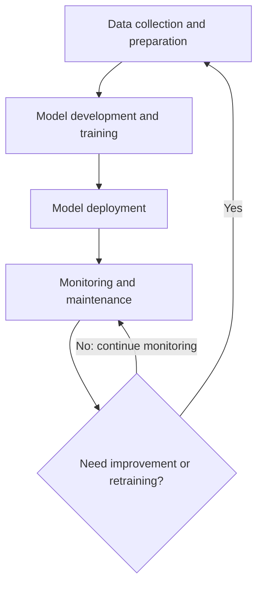
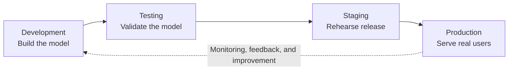

# Introduction to AI Deployment Lifecycle

> **Course:** AI Deployment, Automation & Real-World Applications  
> **Module:** Module 1 — Foundations of AI Deployment & Production Readiness  
> **Lesson:** 1 of 80  
> **Source lesson title:** Introduction to AI Deployment Lifecycle

---

## Lesson Overview

Welcome to the foundational module of the AI Deployment, Automation & Real-World Applications course. As B-Tech students, you're poised to not only build sophisticated AI models but also to ensure they deliver tangible value in real-world scenarios.

This lesson, **Introduction to AI Deployment Lifecycle**, is the first step in understanding how AI models transition from experimental code to robust, operational systems. It covers the journey from the initial idea to the continuous refinement of a deployed AI solution.

By the end of this lesson, you should be able to:

- Understand the AI model deployment lifecycle.
- Define key terms related to AI production.
- Identify prerequisites for successful AI deployment.
- Outline the benefits of robust deployment strategies.

This knowledge is important for aspiring AI professionals who want to make a real impact. The AI/ML lifecycle is not just about training a model; it is about making that model accessible, reliable, and valuable to end-users or other systems.

The lesson introduces the distinct phases involved, the roles of individuals and teams, and common hurdles that can impede progress. It also connects theoretical concepts to practical applications and real-world challenges.

## 1. Visualizing the AI/ML Lifecycle

The AI/ML lifecycle is a comprehensive framework that guides the development, deployment, and maintenance of artificial intelligence and machine learning models. It is a **cyclical process**, emphasizing continuous improvement and adaptation.

The lifecycle transforms raw data into intelligent, actionable insights and ensures that an AI solution continues to provide value.

### 1.1 Data Collection and Preparation: The Foundation of Intelligence

This initial phase is arguably the most critical. The quality and relevance of the data directly influence the performance and reliability of an AI model.

**Activities**

1. **Data sourcing**
   - Identify and gather data from sources such as databases, APIs, sensors, user interactions, or publicly available datasets.
   - The choice of sources depends on the problem being solved.
   - Example: A sentiment-analysis model might use social-media feeds and customer reviews. A predictive-maintenance model might use sensor data from industrial equipment.

2. **Data cleaning**
   - Address inconsistencies, missing values, outliers, and duplicate entries.
   - Real-world data is often messy.
   - Techniques include imputation (filling missing values), outlier detection and removal, and standardization.
   - Example: A temperature reading recorded as `1000°C` is likely an error that needs correction or removal.

3. **Data transformation**
   - Convert raw data into a format suitable for model training.
   - This can include:
     - Feature engineering: creating new features from existing ones.
     - Scaling numerical features, for example to a range of 0–1.
     - Encoding categorical variables, for example one-hot encoding.
     - Dimensionality reduction.
   - Example: For customer-churn prediction, a `recency` feature could be engineered from the last purchase date.

4. **Data labeling (for supervised learning)**
   - Assign correct output values (labels) to input data.
   - This is labor-intensive but vital for supervised-learning tasks.
   - Examples:
     - Image classification: humans label images as `cat` or `dog`.
     - Text classification: annotators label emails as `spam` or `not spam`.

**Why this phase matters**

The principle is **“Garbage in, garbage out.”** High-quality, well-prepared data is the foundation of a successful AI model. Poor data can produce biased, inaccurate, and unreliable models regardless of how sophisticated the algorithms are.

**Real-world example: Fraud detection**

A financial institution developing a fraud-detection system needs to collect transaction data, customer demographics, and historical fraud patterns. The data must be cleaned to remove erroneous entries and transformed to create useful features such as:

- Transaction frequency.
- Average transaction amount.
- Time of day.

### 1.2 Model Development and Training: Building the Brains

Once the data is ready, the focus shifts to building and training the AI model.

**Activities**

1. **Algorithm selection**
   - Choose an appropriate machine-learning algorithm based on the problem type (classification, regression, clustering, etc.), data characteristics, and desired performance.
   - Options range from simple linear regression to complex deep neural networks.

2. **Model training**
   - Feed prepared data into the selected algorithm so it can learn patterns and relationships.
   - Training is iterative: the model adjusts its internal parameters to minimize errors.

3. **Hyperparameter tuning**
   - Optimize performance by adjusting hyperparameters: settings that are not learned from data, such as learning rate or the number of layers in a neural network.
   - Common techniques include grid search, random search, and Bayesian optimization.

4. **Model evaluation**
   - Assess the trained model using metrics such as accuracy, precision, recall, F1-score, AUC, and MSE.
   - Evaluation uses a separate validation or test dataset to understand how well the model generalizes to unseen data.

**Why this phase matters**

This is where the core intelligence of the AI is developed. Effective training and evaluation help ensure that the model can accurately perform its intended task.

**Real-world example: Fraud detection**

Data scientists might experiment with Logistic Regression, Random Forests, or Gradient Boosting Machines. They train these models on historical transaction data and evaluate their ability to identify fraudulent transactions while minimizing false positives.

### 1.3 Model Deployment: Bringing AI to Life

Deployment is the stage where the trained model is made available for use in a production environment. It makes the model accessible to applications or users.

**Activities**

1. **Packaging the model**
   - Save the trained model in a format that can be loaded and used.
   - Examples include Python libraries such as `pickle` or `joblib`, or formats specific to deep-learning frameworks.

2. **Creating an inference service**
   - Build an API (for example, using FastAPI) or a microservice.
   - The service receives input data, passes it to the model for prediction, and returns the result.

3. **Infrastructure setup**
   - Deploy the model and service to suitable infrastructure:
     - On-premises servers.
     - Cloud platforms such as AWS, GCP, or Azure.
     - Edge devices.
   - Containerization with Docker and orchestration with Kubernetes may be used for scalability and manageability.

**Why this phase matters**

A model is valuable only when it can be used. Deployment bridges the gap between research and practical application.

**Real-world example: Fraud detection**

Once validated, the fraud-detection model is deployed as a microservice. When a new transaction occurs, the banking application sends transaction details to the service, which predicts whether the transaction is fraudulent in near real time.

### 1.4 Monitoring and Maintenance: Ensuring Ongoing Performance

Deployment is not the end; it is the beginning of the operational phase. Continuous monitoring and maintenance help ensure that the AI system remains effective over time.

**Activities**

1. **Performance monitoring**
   - Track metrics such as prediction accuracy, latency, throughput, and resource utilization.
   - Tools mentioned in the lesson include Prometheus and Grafana.

2. **Drift detection**
   - Identify changes in:
     - **Data drift:** changes in the input-data distribution.
     - **Concept drift:** changes in the relationship between input features and the target variable.
   - The lesson identifies Evidently AI as a tool for detecting drift.

3. **Retraining and updates**
   - Periodically retrain the model with new data to adapt to changing patterns and maintain accuracy.
   - This may involve full redeployment or incremental updates.

4. **Feedback loops**
   - Incorporate feedback from users or downstream systems to identify problems and areas for improvement.

**Why this phase matters**

The real world is dynamic. Models can degrade as data or the operating environment changes. Continuous monitoring helps keep the AI system reliable and effective.

**Real-world example: Fraud detection**

The system is monitored continuously. If it starts flagging legitimate transactions as fraudulent (false positives) or misses actual fraud (false negatives), this may indicate drift. The system might trigger an alert to retrain the model using recent data.

### 1.5 The Lifecycle Is Cyclical

The AI/ML lifecycle is not a one-way linear path. Each stage informs and influences the others, creating an ongoing process of refinement and adaptation.

## 2. AI Deployment Stages: From Conception to Live Operation

Moving an AI model from a research environment into production is a structured process. The lesson divides it into four key stages: **Development, Testing, Staging, and Production**.

Each stage has a distinct purpose and helps ensure that the model is tested, validated, and prepared for a live environment.

### 2.1 Development Stage: The Birthplace of Ideas

The development stage is where the initial AI model is conceived, built, and experimented with. It involves exploration, rapid prototyping, and iterative refinement.

**Primary goal:** Prove the concept and develop a model that shows promising results on historical or simulated data.

**Activities**

- Data exploration, cleaning, and feature engineering.
- Algorithm selection and initial model training.
- Hyperparameter tuning and experimentation.
- Performance evaluation on development datasets.
- Prototyping potential application interfaces or integrations.

**Environment**

Usually local development machines, cloud-based notebooks such as Jupyter, or dedicated development servers. These environments are often less constrained in resources and security than production environments.

**Key deliverables**

- Trained model artifact.
- Initial performance metrics.
- Proof-of-concept code.

**Focus**

Feasibility, accuracy, and algorithmic innovation. The emphasis is on demonstrating that the AI can learn and perform the desired task in a controlled setting.

**Tools mentioned**

- Python libraries: Pandas, NumPy, Scikit-learn, TensorFlow, and PyTorch.
- IDEs: VS Code and PyCharm.
- Notebook environments: Jupyter and Colab.

**Why it matters**

This stage validates the core idea and technical feasibility. Without a functional model, there is nothing to deploy.

**Real-world example: Plant-disease recognition**

A team of data scientists develops an image-recognition model to identify plant diseases. They collect, clean, and label plant images, experiment with convolutional neural-network architectures, and train models on local machines to classify diseases accurately.

### 2.2 Testing Stage: Rigorous Validation and Quality Assurance

Once a promising model has been developed, it moves to testing.

**Primary goal:** Validate performance, robustness, and reliability under different conditions, simulating real-world scenarios as closely as possible.

This stage identifies bugs, performance bottlenecks, and failure points before the model affects live users.

**Testing activities**

1. **Unit testing**
   - Test individual components of the model and associated code.
   - Examples: data-preprocessing functions and prediction endpoints.

2. **Integration testing**
   - Verify that the model integrates correctly with other components, such as data pipelines, APIs, and user interfaces.

3. **Performance testing**
   - Evaluate speed (latency), capacity (throughput), and resource consumption under expected and peak loads.

4. **Stress testing**
   - Push the system beyond normal operating limits to understand breaking points and failure modes.

5. **Security testing**
   - Identify vulnerabilities that could be exploited, especially when sensitive data is handled.

6. **User Acceptance Testing (UAT)**
   - Involve end-users or domain experts to validate whether the model meets their requirements and expectations.

7. **Bias and fairness testing**
   - Check that the model does not exhibit unfair biases toward certain demographic groups.

**Environment**

A dedicated testing environment that closely mirrors production in hardware, software, and data configurations. This may be a staging server or a separate cloud environment.

**Key deliverables**

- Test reports.
- Bug logs.
- Performance benchmarks.
- A validated model ready for the next stage.

**Focus**

Reliability, correctness, performance, and security. The aim is to ensure that the model behaves as expected and has no critical defects.

**Tools mentioned**

- Python testing frameworks such as `pytest`.
- Load-testing tools such as JMeter.
- Security-scanning tools.
- Specialized AI-testing platforms.

**Why it matters**

Testing acts as a quality gate. It prevents flawed or underperforming models from reaching production, helping avoid costs and reputational damage.

**Real-world example: Plant-disease recognition**

Automated tests check whether the prediction API returns the correct formats. Load tests simulate thousands of image uploads per minute to check responsiveness. Domain experts review sample predictions to confirm accuracy and identify misclassifications that automated tests did not catch.

### 2.3 Staging Stage: The Dress Rehearsal for Production

The staging environment is a near-exact replica of production. It provides a final, realistic preview before the system goes live.

**Primary goal:** Catch environment-specific issues that may not have appeared during testing.

**Activities**

- **End-to-end system testing:** Test the complete application flow, including the AI model, dependencies, and user interfaces, in a production-like setting.
- **Configuration validation:** Check database connections, network settings, environment variables, and other production configurations.
- **Deployment simulation:** Practise the actual deployment process to identify problems with deployment scripts or procedures.
- **Performance tuning:** Make final adjustments to system configurations and model parameters based on staging performance.
- **Rollback strategy testing:** Verify that reverting to a previous stable version works and can be done efficiently.

**Environment**

A dedicated staging server or cloud environment configured like production. It may use production-like data volumes, with data anonymized or sampled.

**Key deliverables**

- Fully integrated and validated system.
- Tested deployment plan.
- Final go/no-go decision for production.

**Focus**

Integration, environment parity, and deployment readiness. The emphasis is on a smooth transition to the live environment.

**Tools mentioned**

- Infrastructure-as-Code tools: Terraform and CloudFormation.
- CI/CD tools: Jenkins, GitLab CI, and GitHub Actions.
- Monitoring tools configured for staging.

**Why it matters**

Staging is the final safety net. It reduces the risk of unexpected failures or performance degradation after launch.

**Real-world example: Plant-disease recognition**

The system is deployed to staging. The team simulates the complete workflow: a farmer uploads a photo, the image is processed, the AI predicts the disease, and the result is displayed. The team also tests the deployment script intended for the live system.

### 2.4 Production Stage: The Live Environment

Production is the live environment where the AI model serves its intended purpose and delivers value to end-users or business processes.

**Primary characteristics:** Continuous operation, monitoring, and maintenance.

**Activities**

- **Real-time inference:** The model makes predictions using live data.
- **Continuous monitoring:** Track performance metrics, system health, anomalies, and drift.
- **Incident response:** Address issues or failures in the live system promptly.
- **Regular maintenance:** Apply security patches, update dependencies, and perform routine checks.
- **Iterative improvement:** Collect feedback and data for future model updates and retraining.

**Environment**

Live production servers, cloud instances, or edge devices accessible to the intended audience. Production is typically highly secured, performance-optimized, and equipped with fault-tolerance mechanisms.

**Key deliverables**

- Operational AI service.
- Ongoing performance reports.
- Delivery of value to users.

**Focus**

Reliability, scalability, availability, and continuous value delivery.

**Tools mentioned**

- Cloud platforms: AWS, GCP, and Azure.
- Container orchestration: Kubernetes.
- Monitoring and logging: Prometheus, Grafana, and ELK Stack.
- Alerting systems and MLOps platforms.

**Why it matters**

This is where the AI solution fulfills its purpose and generates return on investment (ROI). A well-managed production environment helps ensure continued success and impact.

**Real-world example: Plant-disease recognition**

The app is live and farmers can upload crop images. The deployed AI service processes images in real time and provides diagnoses and treatment recommendations. The system is monitored for uptime, prediction speed, and accuracy, with alerts for deviations.

### 2.5 Comparing the Four Deployment Stages

| Stage | Main purpose | Typical environment | Key deliverables | Main focus |
|---|---|---|---|---|
| Development | Build and prove the model | Local machines, notebooks, development servers | Model artifact, initial metrics, proof-of-concept code | Feasibility and accuracy |
| Testing | Validate correctness and robustness | Dedicated test environment | Test reports, bug logs, benchmarks | Reliability, performance, security |
| Staging | Rehearse production deployment | Production-like environment | Integrated system, tested deployment plan, go/no-go decision | Integration and deployment readiness |
| Production | Serve real users and business processes | Live servers, cloud, or edge devices | Operational service and performance reports | Reliability, scalability, availability |

## 3. Key Stakeholders and Their Roles

Successful AI deployment is a collaborative effort. Different people and teams contribute distinct expertise and responsibilities. Roles vary by organization, but the core functions remain consistent.

### 3.1 Data Scientists / ML Engineers: The Model Builders

**Role:** Design, develop, train, and evaluate AI models. They have expertise in machine-learning algorithms, statistical modeling, and data analysis.

**Deployment responsibilities**

- Develop and optimize the AI model.
- Select appropriate algorithms and features.
- Ensure model performance and accuracy.
- Prepare the model artifact for deployment, such as saving weights and defining inference logic.
- Collaborate with engineers to integrate the model into applications.
- Monitor production model performance and initiate retraining when necessary.

**Why they are critical**

They are the technical backbone responsible for the AI system's core intelligence. Their understanding of the model is essential for troubleshooting and improvement.

**Example**

Dr. Anya Sharma, a Senior ML Engineer, develops a deep-learning model for medical-image analysis. She handles training and validation and provides the deployment team with the trained model file, such as a TensorFlow SavedModel.

### 3.2 Software Engineers / Backend Developers: The System Integrators

**Role:** Build the applications and services that host and interact with the AI model. They integrate the model into the broader software ecosystem.

**Deployment responsibilities**

- Develop APIs to serve model predictions, for example using FastAPI.
- Integrate the AI model into existing applications or build new ones.
- Manage data pipelines that feed data to the model and process its outputs.
- Ensure application infrastructure is robust and scalable.
- Implement user interfaces that use AI capabilities.

**Why they are critical**

They turn the model's potential into a functional product or service that users can interact with. They make the model accessible and reliable within the application.

**Example**

Ben Carter, a Backend Engineer, builds a REST API using FastAPI. It accepts user queries, sends them to Dr. Sharma's medical-image analysis model, and returns diagnostic suggestions to the frontend application.

### 3.3 DevOps / MLOps Engineers: The Deployment and Operations Specialists

**Role:** Bridge development and operations. They automate and streamline the deployment, management, and monitoring of AI systems.

**MLOps** (Machine Learning Operations) is a specialized discipline within DevOps tailored to machine-learning workflows.

**Deployment responsibilities**

- Set up and manage CI/CD pipelines for AI models.
- Containerize applications and models using Docker.
- Orchestrate deployments using tools such as Kubernetes.
- Configure and manage cloud infrastructure on AWS, GCP, or Azure.
- Implement monitoring, logging, and alerting systems.
- Ensure reproducibility and version control for models and code.
- Automate model-retraining and deployment processes.

**Why they are critical**

They help AI models deploy efficiently, reliably, and at scale, while ensuring that production performance is continuously monitored and maintained.

**Example**

Maria Rodriguez, an MLOps Engineer, creates a CI/CD pipeline that automatically builds a Docker image whenever a new model version is committed. She configures Kubernetes for high availability and automatic scaling based on traffic, and uses Prometheus and Grafana to monitor service health and prediction latency.

### 3.4 Product Managers: The Visionaries and Strategists

**Role:** Define the vision, strategy, and roadmap for AI-powered products. They understand market needs and translate them into actionable requirements.

**Deployment responsibilities**

- Define the business problem the AI is intended to solve.
- Prioritize AI features and use cases.
- Gather user requirements and translate them into technical specifications.
- Manage stakeholder expectations and communicate progress.
- Ensure the deployed AI solution aligns with business goals and delivers value.
- Make decisions about feature releases and product iterations.

**Why they are critical**

They keep AI development aligned with business objectives and ensure the final product meets market demands and delivers tangible value.

**Example**

David Lee, a Product Manager, identifies a need for an AI diagnostic tool for radiologists. He works with Dr. Sharma and Ben Carter to define features, prioritize diseases to detect, and set the release timeline.

### 3.5 Quality Assurance (QA) Engineers: The Guardians of Quality

**Role:** Ensure the overall quality, functionality, and reliability of the AI system and its applications.

**Deployment responsibilities**

- Develop and execute test plans and test cases.
- Identify, document, and track bugs and issues.
- Perform functional, performance, regression, and UAT testing.
- Validate that model outputs are correct and consistent.
- Ensure the system meets specified requirements.

**Why they are critical**

They act as quality gatekeepers, helping ensure that only well-tested systems are released to production.

**Example**

Sarah Chen, a QA Engineer, designs test cases for the medical-image analysis application. She checks whether the AI identifies common diseases correctly, whether the interface is intuitive, and whether the system handles errors gracefully.

### 3.6 Business Stakeholders / End-Users: The Ultimate Beneficiaries

**Role:** The people who use the AI system or benefit from its outputs. They provide context for development and are the ultimate judges of success.

**Deployment responsibilities**

- Provide domain expertise and requirements.
- Participate in User Acceptance Testing (UAT).
- Give feedback about usability and effectiveness.
- Adopt and use the AI system in daily workflows.

**Why they are critical**

Adoption and satisfaction are ultimate measures of success. User feedback is valuable for continuous improvement.

**Example**

Radiologists use the medical-image analysis tool. They provide feedback about the accuracy and usefulness of diagnostic suggestions, helping refine the model and application.

### 3.7 Stakeholder Collaboration

Effective communication and collaboration among stakeholders are essential. Shared understanding of goals, responsibilities, and the deployment lifecycle helps the journey from concept to production run smoothly and produce a valuable AI solution.

| Stakeholder | Primary contribution |
|---|---|
| Data Scientist / ML Engineer | Builds, trains, evaluates, and prepares the model |
| Software / Backend Engineer | Builds APIs and integrates the model into applications |
| DevOps / MLOps Engineer | Automates deployment and manages infrastructure and operations |
| Product Manager | Aligns the solution with user needs and business goals |
| QA Engineer | Tests quality, reliability, and correctness |
| Business Stakeholder / End-User | Supplies domain context, validates usefulness, and provides feedback |

## 4. Common Challenges in AI Production

Deploying an AI model is often more complex than developing it. Real-world conditions can hinder deployment, degrade performance, and affect the success of an AI initiative.

Recognizing common pitfalls is the first step toward mitigating them.

### 4.1 Data Drift and Concept Drift: The Evolving Landscape

**Data drift**

Changes in the statistical properties or distribution of input data over time.

Examples:

- Customer demographics shift.
- Sensor readings change because of environmental factors.

**Concept drift**

Changes in the underlying relationship between input features and the target variable.

Examples:

- User preferences evolve.
- The definition of what constitutes fraud changes because of new attack methods.

**Why this is a challenge**

Models trained on historical data may become less accurate or irrelevant as real-world data and concepts evolve. This causes performance degradation.

**How to address it**

- Implement monitoring systems, for example using Evidently AI.
- Establish automated retraining pipelines to update models periodically or when significant drift is detected.
- Version data and models to support reproducibility.

**Real-world example**

A spam-detection model starts missing new types of spam because spammers continually change their tactics (concept drift). If a company expands into a new geographic region, the demographic distribution of its users may change, causing data drift.

### 4.2 Scalability and Performance Bottlenecks: Meeting Demand

**What it is**

The AI system cannot handle the volume of requests or the response speed required in production. This can appear as:

- **High latency:** Slow response times.
- **Low throughput:** Inability to process many requests per unit of time.

**Why this is a challenge**

A model that works on a small test set may struggle under thousands or millions of real-time requests. This can harm user experience, lose business opportunities, or cause system failures.

**How to address it**

- Optimize inference speed using techniques such as model quantization or pruning.
- Use specialized inference engines such as vLLM for large language models (LLMs).
- Use scalable infrastructure such as cloud auto-scaling groups.
- Use container orchestration such as Kubernetes.
- Employ load balancing.
- Design efficient APIs and data pipelines.

**Real-world example**

An e-commerce recommendation engine works during development but struggles during a holiday sale. Slow page loads frustrate shoppers.

### 4.3 Reproducibility and Versioning: The Quest for Consistency

**What it is**

The difficulty of recreating the exact same model or deployment environment later. This includes tracking:

- Which data version was used.
- Which code was executed.
- Which hyperparameters were configured.

**Why this is a challenge**

A lack of reproducibility makes debugging difficult, hinders collaboration, and makes rollback to a known-good state harder. It can also affect regulatory compliance in some industries.

**How to address it**

- Use Git for code version control.
- Use DVC or cloud-storage versioning for data.
- Version model artifacts.
- Use experiment-tracking tools such as MLflow to log parameters, metrics, and artifacts for each training run.
- Use Docker to maintain consistent environments.

**Real-world example**

A team cannot reproduce a high-performing model because it did not track the dataset version used for training. This creates wasted effort and uncertainty about the model's reliability.

> **Source note:** The original lesson repeats the definition, challenge, and mitigation text for reproducibility/versioning. The repeated material is consolidated here once; its meaning and listed tools are retained.

### 4.4 Monitoring and Alerting: Knowing When Something Is Wrong

**What it is**

The absence of effective systems for tracking the health, performance, and accuracy of a deployed model and its infrastructure.

**Why this is a challenge**

Without monitoring, performance degradation, outages, or security breaches may go unnoticed until they cause significant damage or affect users. Proactive detection is more effective than reactive problem-solving.

**How to address it**

- Use Prometheus for metrics.
- Use Grafana for visualization.
- Use the ELK Stack for logging.
- Define key performance indicators (KPIs).
- Set alerts for deviations from expected behavior.
- Monitor system health and model-specific metrics such as prediction latency, error rates, and drift indicators.

**Real-world example**

A deployed chatbot's accuracy silently degrades over several weeks because nobody monitors response quality. User frustration increases and engagement declines.

### 4.5 Integration Complexity: Connecting the Pieces

**What it is**

The difficulty of integrating the AI model and its services with existing IT systems, databases, and user interfaces.

**Why this is a challenge**

Legacy systems, different technology stacks, and complex data flows can make integration difficult. Incompatible data formats, network issues, and security protocols can create roadblocks.

**How to address it**

- Use well-defined APIs, such as RESTful APIs built with FastAPI.
- Use Docker and Kubernetes to standardize deployment and communication.
- Adopt a microservices architecture where appropriate.
- Perform thorough integration testing in staging environments.

**Real-world example**

An AI model designed to predict customer lifetime value cannot be integrated into a CRM system because the data formats are incompatible. Significant custom middleware development is then required.

### 4.6 Model Explainability and Trust: The Black Box Problem

**What it is**

The difficulty of understanding why a model makes a particular prediction, especially for complex models such as deep neural networks. This lack of transparency can reduce trust.

**Why this is a challenge**

In regulated industries such as finance and healthcare, decisions may need to be explained. Users may hesitate to trust a system they do not understand, reducing adoption.

**How to address it**

- Use explainability techniques such as LIME and SHAP to provide insights into predictions.
- Choose simpler, more interpretable models when possible without significantly compromising performance.
- Clearly communicate the model's capabilities and limitations to stakeholders.

**Real-world example**

An AI model rejects a loan application, but the bank cannot explain the reason to the applicant because of the model's complexity. This can lead to legal issues and customer dissatisfaction.

### 4.7 Challenge Summary

| Challenge | Meaning | Example response / mitigation |
|---|---|---|
| Data drift | Input-data distribution changes | Monitor data and retrain with fresh data |
| Concept drift | Relationship between inputs and target changes | Detect changes and update the model |
| Scalability and performance | System cannot meet request volume or speed | Quantization, pruning, vLLM, autoscaling, Kubernetes, load balancing |
| Reproducibility and versioning | Model or environment cannot be recreated consistently | Git, DVC, storage versioning, MLflow, Docker |
| Monitoring and alerting | Problems are not detected promptly | Prometheus, Grafana, ELK Stack, KPIs, alerts |
| Integration complexity | Model does not connect easily to existing systems | REST APIs, FastAPI, Docker, Kubernetes, microservices, staging tests |
| Explainability and trust | Predictions are difficult to understand | LIME, SHAP, interpretable models, clear communication |

The lesson concludes that addressing these challenges requires a proactive, **MLOps-centric approach**, emphasizing automation, robust monitoring, continuous integration, and a deep understanding of both the AI model and its production environment.

## 5. Tools and Technologies Mentioned in This Lesson

This section gathers the tools named in the source lesson. It does not imply that the lesson provided setup instructions or hands-on exercises for each tool.

| Tool / technology | Context in which it appears |
|---|---|
| Python | Model development and experimentation |
| Pandas, NumPy | Data handling and numerical work |
| Scikit-learn | Machine-learning algorithms |
| TensorFlow, PyTorch | Model development and training |
| VS Code, PyCharm | Development environments / IDEs |
| Jupyter, Colab | Notebook environments |
| `pickle`, `joblib` | Saving model artifacts |
| FastAPI | Building inference APIs and REST services |
| Docker | Containerization and environment consistency |
| Kubernetes | Container orchestration and scaling |
| AWS, GCP, Azure | Cloud infrastructure |
| Prometheus | Monitoring metrics |
| Grafana | Monitoring visualization |
| Evidently AI | Drift detection |
| Terraform, CloudFormation | Infrastructure as Code |
| Jenkins, GitLab CI, GitHub Actions | CI/CD |
| `pytest` | Python testing |
| JMeter | Load testing |
| Git | Code version control |
| DVC | Data versioning |
| MLflow | Experiment tracking |
| vLLM | Specialized LLM inference |
| ELK Stack | Logging |
| LIME, SHAP | Model explainability |

## 6. Important Terminology from the Lesson

| Term | Meaning in the context of this lesson |
|---|---|
| AI/ML lifecycle | The cyclical process of developing, deploying, monitoring, and maintaining an AI/ML model |
| Production environment | The live environment where the AI system serves users or business processes |
| Data sourcing | Gathering data from relevant sources |
| Data cleaning | Handling missing values, inconsistencies, outliers, and duplicates |
| Feature engineering | Creating useful features from existing data |
| Data labeling | Assigning correct target labels to input data for supervised learning |
| Model artifact | A saved model that can be loaded for deployment or inference |
| Inference | Using a trained model to generate a prediction from input data |
| API | An interface through which software components communicate |
| Microservice | A service that provides a focused capability and can be integrated with other services |
| Hyperparameter | A model-training setting that is not learned directly from the training data |
| Latency | The time taken to respond to a request |
| Throughput | The amount of work or number of requests processed per unit of time |
| Data drift | A change in the statistical distribution of input data |
| Concept drift | A change in the relationship between input features and the target |
| CI/CD | Continuous Integration and Continuous Delivery/Deployment practices and pipelines |
| MLOps | Practices for operating and managing machine-learning systems |
| Staging | A production-like environment used for final validation before release |
| Rollback | Reverting a deployment to a previous stable version |
| UAT | User Acceptance Testing, in which users or domain experts validate the system |
| KPI | Key Performance Indicator used to track performance against an objective |
| ROI | Return on Investment |

## 7. Revision Checklist

Use this checklist to test whether you can explain the lesson without rereading every section.

- [ ] Explain why AI deployment is more than model training.
- [ ] Describe all four phases of the AI/ML lifecycle.
- [ ] Explain data sourcing, cleaning, transformation, and labeling.
- [ ] Distinguish model parameters from hyperparameters.
- [ ] Explain model packaging and inference services.
- [ ] Explain why monitoring and maintenance continue after deployment.
- [ ] Describe Development, Testing, Staging, and Production.
- [ ] Compare the purpose and deliverables of all four deployment stages.
- [ ] Explain the responsibilities of all six stakeholder groups.
- [ ] Distinguish data drift from concept drift.
- [ ] Explain latency and throughput.
- [ ] Describe why reproducibility and versioning matter.
- [ ] Name the tools listed for monitoring, versioning, deployment, and explainability.
- [ ] Explain integration complexity and the black-box problem.
- [ ] Explain why an MLOps-centric approach is useful.

## 8. Self-Test / Interview-Style Questions

The following questions are derived from the concepts covered in this lesson.

1. What is the AI/ML lifecycle, and why is it cyclical?
2. Why is data preparation considered a critical stage?
3. What is the difference between data cleaning and data transformation?
4. What is the purpose of hyperparameter tuning?
5. What happens during model deployment?
6. Why does a deployed model need an inference service?
7. What is the difference between latency and throughput?
8. What is the difference between Development, Testing, Staging, and Production?
9. Why should a staging environment resemble production?
10. What is rollback testing, and why is it important?
11. How do ML Engineers and Backend Engineers contribute differently to deployment?
12. What is the role of an MLOps Engineer?
13. What is data drift? Give an example.
14. What is concept drift? Give an example.
15. How can Git, DVC, MLflow, and Docker support reproducibility?
16. Why are monitoring and alerting necessary after deployment?
17. How can FastAPI help integrate a model into an application?
18. What is model explainability, and why can it matter in healthcare or finance?
19. What are LIME and SHAP mentioned for?
20. Why does the lesson recommend a proactive, MLOps-centric approach?

## 9. Lesson Takeaways

- Building a model is only one part of delivering an AI solution; the model must also be packaged, served, monitored, and maintained.
- The AI/ML lifecycle consists of data preparation, model development and training, deployment, and ongoing monitoring and maintenance.
- A common deployment pathway consists of Development → Testing → Staging → Production.
- AI deployment requires collaboration among model builders, software engineers, MLOps/DevOps engineers, product managers, QA engineers, and end-users.
- Production systems face changing data, scaling demands, reproducibility problems, monitoring needs, integration challenges, and explainability requirements.
- Monitoring, versioning, automation, and continuous improvement are essential parts of operating AI systems.

---

## Source Coverage and Documentation Notes

- **Source:** User-provided internship lesson text, “Lesson 1 of 80 — Introduction to AI Deployment Lifecycle.”
- The documentation preserves the lesson's main organization, concepts, examples, stakeholders, challenges, and named tools.
- The source repeats the reproducibility/versioning explanation twice; the repeated passage is consolidated into one section and explicitly noted.
- Tables, revision checklists, terminology summaries, and Mermaid diagrams are organizational aids created from the source material.
- No assessment questions or official assessment answers were included in the supplied lesson text. The self-test questions above are revision questions derived from the lesson, not official assessment questions.
