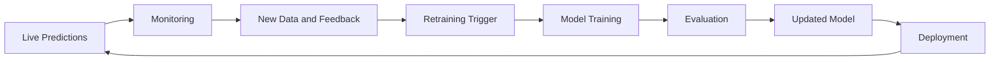

# Practical Application of the AI Deployment Lifecycle

> **Course:** AI Deployment, Automation & Real-World Applications  
> **Lesson:** 1 of 80 — Introduction to the AI Deployment Lifecycle  
> **Section:** Practical exercises, guided walkthrough, production best practices, and lesson recap

---

## 1. Interactive Exercise: Mapping a Project to the AI Lifecycle

This exercise applies the four major AI/ML lifecycle stages to a realistic project. Choose **one** scenario and identify at least 3–5 activities for each stage.

### Choose one project scenario

| Scenario | Project goal |
|---|---|
| **A. Personalized e-commerce recommendation engine** | Recommend products to shoppers using browsing history, purchase patterns, and demographic information. |
| **B. Customer churn prediction model** | Predict which subscription-service customers may stop using the service so the company can offer retention incentives. |
| **C. Automated image captioning for social media** | Generate descriptive captions for uploaded images to improve accessibility and searchability. |

### The four lifecycle stages

1. **Data Collection & Preparation**
2. **Model Development & Training**
3. **Model Deployment**
4. **Monitoring & Maintenance**

### Example mapping: Scenario A — Recommendation engine

#### Data Collection & Preparation

- Gather user clickstream data from website logs.
- Collect purchase history from the order database.
- Clean and anonymize user data.
- Engineer features such as user-engagement scores and product-popularity metrics.
- Split the data into training, validation, and test sets.

#### Model Development & Training

- Select a collaborative-filtering or content-based-filtering algorithm.
- Train the recommendation model on historical user–item interactions.
- Tune hyperparameters to improve recommendation quality, using metrics such as Precision@K.
- Evaluate performance with Mean Average Precision (MAP).
- Experiment with different embedding techniques.

#### Model Deployment

- Package the trained recommendation model.
- Build a FastAPI service to serve recommendations.
- Containerize the service with Docker.
- Deploy the container to a Kubernetes cluster.
- Integrate the recommendation API into the e-commerce website's frontend.

#### Monitoring & Maintenance

- Monitor recommendation click-through and conversion rates.
- Track API latency and throughput.
- Detect data drift in user behaviour.
- Periodically retrain the model with new interaction data.
- A/B test new recommendation algorithms or features.

### Discussion prompts

After completing the mapping, consider:

- Do any activities span more than one lifecycle stage?
- Which stage would be the most challenging for your chosen project, and why?
- How could Python, Docker, FastAPI, Kubernetes, and Evidently AI be used across the project's lifecycle?

> **Participation note:** The instructor may facilitate this discussion using a shared document or whiteboard to collect responses and identify common themes.

---

## 2. Discussion Forum: Sharing AI Deployment Hurdles

Theory explains the AI deployment lifecycle, but real projects reveal challenges that may be difficult to anticipate. This discussion is intended to help learners share experiences and learn from one another.

### Discussion task

Reflect on a previous project, academic assignment, or hypothetical AI system. Share **one significant challenge** you faced or expect to face during deployment or production.

Cover these four points:

1. **The AI project:** What was the goal of the model or system?
2. **The challenge:** What specific deployment or production hurdle did you encounter or anticipate? Examples include data drift, scalability, integration problems, stakeholder buy-in, ethical concerns, or monitoring gaps.
3. **Your approach:** How did you address it, or what strategy would you use?
4. **Lessons learned:** What is the most important takeaway?

### Example discussion response

**AI project:** A sentiment-analysis model for customer-feedback emails.

**Challenge:** After deployment, the model's accuracy dropped. It began classifying neutral feedback as negative. The language used in customer emails had changed, with new slang and informal phrasing that was missing from the training data. This is an example of **concept drift**.

**Approach:** Introduce a feedback loop in which customer-support agents can flag misclassified emails. Collect flagged examples and use them for periodic retraining. Monitor the rate of flagged emails and create alerts that can prompt investigation or retraining.

**Lesson learned:** Continuous monitoring and human feedback are important for maintaining model performance in changing environments. Initial training alone is not enough to guarantee long-term performance.

### Themes to consider

- **Cross-functional collaboration:** Data Scientists, ML Engineers, Software Engineers, DevOps Engineers, Product Managers, and other stakeholders must work together.
- **Organizational culture:** The way an organization approaches experimentation and AI adoption can affect deployment.
- **Model complexity versus deployability:** A more complex model is not automatically the best production choice.
- **Tools and automation:** Automation can reduce repetitive work and help manage deployment challenges.
- **Ethics:** Fairness, transparency, privacy, and responsible use matter throughout deployment and operation.

> **Participation note:** This discussion may take place in a live session or an online forum. Learners are encouraged to share experiences and ask one another questions.

---

## 3. Guided Walkthrough: House-Price Prediction from Development to Production

This walkthrough follows a simple hypothetical machine-learning project through the deployment lifecycle.

### Project goal

Build a model that predicts a house's sale price using its square footage and number of bedrooms.

### Stage 1 — Development: Building the foundation

#### Data collection and preparation

- **Source:** A CSV file containing historical house-sale records.
- **Features:** Square footage, number of bedrooms, and location.
- **Target:** Sale price.

Activities:

1. Load the CSV file into a Pandas DataFrame.
2. Handle missing values. The lesson's example suggests imputing an average value for missing entries.
3. Consider feature engineering, such as calculating price per square foot. The simplified walkthrough keeps the original features for the model.
4. Split the data into training and testing sets, using an 80:20 split with `train_test_split` from Scikit-learn.

#### Model development and training

- **Algorithm:** Linear Regression (`LinearRegression` from Scikit-learn), chosen because the example is straightforward and uses a limited number of features.

Activities:

1. Instantiate the `LinearRegression` model.
2. Train it with the training data using `model.fit(X_train, y_train)`.
3. Evaluate it on the test data using Mean Squared Error (MSE) and R-squared. The example also mentions `model.score(X_test, y_test)` for the score.
4. Save the trained model artifact using Joblib:

```python
import joblib

joblib.dump(model, "house_price_model.pkl")
```

**Important terms**

| Term | Meaning in this walkthrough |
|---|---|
| Feature | An input used by the model, such as square footage or number of bedrooms. |
| Target | The value the model is trained to predict: sale price. |
| Training set | The data used to fit the model. |
| Test set | Held-out data used to evaluate the trained model. |
| Model artifact | The saved, trained model file that can be loaded later. |

### Stage 2 — Testing: Ensuring robustness

The goal is to check that the data pipeline and model behave as expected before moving towards production.

| Test type | What to test |
|---|---|
| **Unit tests** | Use Python tests (for example, with `pytest`) to check that data-loading functions handle expected file formats and that the saved model artifact loads successfully. |
| **Integration tests** | Simulate receiving new house data, pass it to the loaded model, and verify the prediction output's format and expected range. |
| **Performance tests** | Measure how long the prediction script takes to process 100 simulated data points. The lesson gives an example target of under one second. |
| **Edge-case tests** | Try unusual values, such as extremely large or small house sizes or zero bedrooms, and check whether the system produces reasonable results or handles the input safely. |

### Stage 3 — Staging: The production rehearsal

A staging environment is a production-like environment in which the team can test the application before releasing it to real users.

#### Environment setup

1. Create a `Dockerfile`.
2. Install Python and the required libraries: Pandas, Scikit-learn, and Joblib.
3. Copy the model artifact and prediction script into the image.
4. Build a Docker image.
5. Run the image as a container and expose a port, such as `8000`.

#### API development with FastAPI

Wrap the prediction logic in a FastAPI application.

Example request:

```json
{
  "square_footage": 1500,
  "bedrooms": 3
}
```

Create an endpoint such as `/predict` that accepts the JSON input and returns the predicted house price.

#### Deployment simulation and configuration checks

- Deploy the Docker container to a staging server or a local Kubernetes environment such as Minikube.
- Call the FastAPI endpoint and check that it is accessible and returns a prediction.
- Verify that any required environment variables are configured correctly for staging.

### Stage 4 — Production: Live operation and evolution

#### Deployment

- Deploy the approved Docker image to the production Kubernetes cluster.
- Configure autoscaling based on incoming prediction requests.
- Use load balancers to distribute incoming traffic.

#### Monitoring and maintenance

**Infrastructure monitoring**

Use Prometheus and Grafana to monitor:

- CPU and memory usage of prediction-service pods.
- Network traffic.
- Error rates.

**Model and input monitoring**

Because this is a supervised model, actual accuracy cannot necessarily be measured immediately for every live prediction: the ground-truth sale price may not yet be available.

The walkthrough therefore recommends monitoring:

- **Prediction latency:** How long each prediction takes.
- **Input-data distribution:** Track the distribution of `square_footage` and `bedrooms`. A significant change from the training-data distribution may indicate data drift.
- **Outlier detection:** Flag predictions that are unusually high or low compared with historical predictions.

Evidently AI is mentioned as a tool that could be adapted to monitor data distributions, although the lesson notes that applying it to this simple regression example may be more involved.

#### Retraining and feedback

- Periodically collect new house-sale data; the example suggests monthly retraining.
- Retrain and re-evaluate the model.
- If the new model performs better, release it using a blue-green deployment or canary release strategy.
- When actual sale prices become available, compare them with the model's predictions.
- Use the resulting errors to evaluate performance and inform future retraining.

### End-to-end flow


### Continuous improvement loop



**Main idea:** Deployment is not the end of the project. Production observations and new data feed back into the model-development process.

---

## 4. Best Practices for a Seamless Transition to Production

Moving an AI model from development to production requires both technical preparation and coordinated teamwork. The following six practices help improve reliability, maintainability, and the ability to deliver value over time.

### 1. Embrace automation

**What it means:** Automate repeatable work across data preprocessing, model training, testing, deployment, and monitoring.

**Why it matters:**

- Reduces manual errors.
- Speeds up deployment.
- Improves consistency.
- Frees people to focus on more complex work.

**How to implement it:**

- Use CI/CD platforms such as GitHub Actions, GitLab CI, or Jenkins.
- Use Infrastructure as Code (IaC) tools such as Terraform or CloudFormation.
- Script repetitive tasks with Python or shell scripts.

**Example:** A CI/CD pipeline detects newly available labelled data, triggers model retraining, runs validation tests, and deploys the updated model to staging for approval before production release.

### 2. Version everything

**What it means:** Track versions of the components needed to reproduce an AI system, including code, data, model artifacts, configurations, and environments.

**Why it matters:**

- Helps debug production issues.
- Supports auditing.
- Makes rollbacks possible.
- Helps reproduce previous experiments and deployments.

**How to implement it:**

| Component | Example tool or approach |
|---|---|
| Code | Git |
| Data | DVC or cloud-storage versioning |
| Experiments and model versions | MLflow |
| Runtime environment and dependencies | Docker |

**Example:** If a production bug occurs, the team can identify the code, data, and model versions that were deployed and investigate or revert to a stable version.

### 3. Implement comprehensive monitoring and alerting

**What it means:** Continuously monitor the health, performance, and accuracy of deployed models and the infrastructure that serves them.

**Why it matters:** Monitoring can reveal performance degradation, data drift, and system failures before they cause greater impact.

**How to implement it:**

- Use Prometheus for metrics collection.
- Use Grafana for visualisation.
- Use the ELK stack (Elasticsearch, Logstash, Kibana) for logs.
- Define key performance indicators (KPIs).
- Configure alerts for important thresholds.
- Monitor infrastructure metrics such as CPU, memory, and latency, as well as model metrics such as accuracy and drift indicators where ground truth or suitable reference data is available.

**Example:** An alert fires when recommendation-service prediction latency exceeds a defined threshold, prompting the team to investigate bottlenecks.

### 4. Plan for rollbacks

**What it means:** Prepare a tested way to return to a previous stable version if a new deployment causes critical problems.

**Why it matters:** A rollback can reduce downtime and limit the impact of a failed release.

**How to implement it:**

- Use blue-green deployments or canary releases.
- Ensure the CI/CD pipeline supports rollback.
- Test rollback procedures in staging.
- Keep records of previous stable versions.

**Example:** A new fraud-detection model causes an unexpected increase in false positives. The team rolls back to the previous stable model while investigating the issue.

### 5. Foster collaboration and communication

**What it means:** Maintain clear communication between the people involved in the AI lifecycle.

**Why it matters:** Misunderstandings and gaps between teams can cause deployment failures. Collaboration helps align goals, requirements, and risk decisions.

**How to implement it:**

- Hold regular cross-functional meetings.
- Use shared documentation.
- Define roles and responsibilities.
- Encourage team members to raise questions and concerns.

**Example:** A weekly meeting brings together the ML and backend teams to discuss model performance, feature requests, and deployment blockers.

### 6. Understand model limitations and biases

**What it means:** Understand where a model may be unreliable, biased, or inappropriate to use.

**Why it matters:** Biased or unreliable systems can produce unfair outcomes, damage trust, and create legal or reputational risks.

**How to implement it:**

- Conduct bias testing during development and testing.
- Use explainability techniques to investigate model decisions.
- Document intended use cases and limitations.
- Involve domain experts and relevant reviewers.

**Example:** Before deploying an AI system that supports hiring recommendations, a team tests for unfair disadvantages across demographic groups and communicates that the model is a support tool rather than the final decision-maker.

---

## 5. Lesson Summary: Mastering the AI Deployment Lifecycle

### Key takeaways

1. **The AI/ML lifecycle is cyclical.** It includes Data Collection & Preparation, Model Development & Training, Model Deployment, and continuous Monitoring & Maintenance. It is an iterative process, not a one-way sequence.
2. **Deployment has distinct stages.** Development, Testing, Staging, and Production each act as a quality gate before the system progresses.
3. **Deployment is collaborative.** Data Scientists and ML Engineers, Software Engineers, DevOps/MLOps Engineers, Product Managers, QA Engineers, and End-Users all contribute to a successful system.
4. **Production introduces challenges.** Common challenges include data and concept drift, scalability, reproducibility, inadequate monitoring, integration complexity, and model explainability.
5. **Good practices reduce production risk.** Automate workflows, version system components, monitor and alert, plan rollbacks, collaborate, and understand model limitations and biases.

### Pro tips for your AI journey

- **Think production-ready from day one:** Consider deployment requirements while developing the model.
- **Document everything:** Documentation supports reproducibility, collaboration, and troubleshooting.
- **Start simple and iterate:** Begin with a functional solution and improve it using real-world feedback and performance.
- **Embrace MLOps:** Apply MLOps practices throughout the workflow to build maintainable systems.

---

## 6. Additional Learning Resources

The lesson recommends exploring:

- **MLOps Community:** Discussions and resources about MLOps practices.
- **Cloud-provider documentation:** AI/ML deployment services from AWS SageMaker, Google Vertex AI, and Azure Machine Learning.
- **Tool documentation:** Docker, Kubernetes, FastAPI, LangChain, Evidently AI, and Streamlit/Gradio.

---

## 7. Preparation for the Next Lesson

The next lesson is **Core Concepts & Production Terminology**. It builds on the lifecycle foundation and introduces the language used in AI operations.

Before moving on, think about these questions:

1. **MLOps:** How are DevOps principles adapted for machine learning?
2. **Model management:** What does it mean to version a model? How can data and code versions be managed?
3. **Performance metrics:** What are inference, latency, and throughput? Why are they important in production?
4. **CI/CD:** How can continuous integration and continuous delivery be applied to machine-learning workflows?

---

## 8. Quick Revision Checklist

Use this checklist to test whether you can explain the section without referring to the notes.

- [ ] Name the four major AI/ML lifecycle stages.
- [ ] Give examples of activities in each stage for one AI project.
- [ ] Explain why development, testing, staging, and production are separate stages.
- [ ] Describe how a house-price model moves from a CSV dataset to a live prediction API.
- [ ] Distinguish unit, integration, performance, and edge-case testing.
- [ ] Explain the roles of Docker, FastAPI, Kubernetes, Prometheus, and Grafana in the walkthrough.
- [ ] Explain why live model accuracy may not be immediately measurable without ground-truth labels.
- [ ] Describe how monitoring and feedback can lead to retraining.
- [ ] List the six production best practices.
- [ ] Explain why versioning and rollback strategies matter.
- [ ] Identify ethical risks such as bias and explainability concerns.

## 9. Self-Test Questions

These questions are study aids derived from the lesson content.

1. Why is the AI/ML lifecycle described as cyclical rather than linear?
2. For a customer-churn model, give three activities for each of the four lifecycle stages.
3. What is the purpose of a staging environment?
4. How do unit tests differ from integration tests?
5. Why might a model's actual accuracy be difficult to calculate immediately after a live prediction?
6. What is the purpose of monitoring input-data distributions?
7. How do blue-green deployment and canary releases help manage deployment risk?
8. Why should code, data, models, configurations, and environments be versioned?
9. Give one example of how automation can support a machine-learning workflow.
10. Why should model limitations and potential biases be documented before deployment?

---

*End of Lesson 1 — Practical Application and Production Best Practices.*
