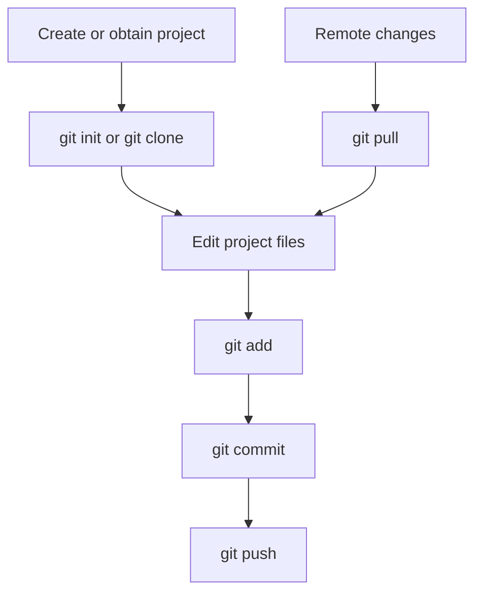

# Lesson 03 — Setting Up Your Production Environment

> **Course:** AI Deployment, Automation & Real-World Applications  
> **Module:** 1 — Foundations of AI Deployment & Production Readiness  
> **Lesson:** 3 of 80  
> **Focus:** Production environment components, Python virtual environments (`venv` and `conda`), Git, and essential command-line interface (CLI) skills.

---

## 1. Lesson Overview

This lesson explains how to prepare an environment for moving AI/ML models from isolated development into production. A well-configured environment is essential for **reproducibility, scalability, maintainability, reliability, and security**.

The lesson introduces practical tools and practices:

- Python virtual environments using `venv` and `conda`
- Git for version control and collaboration
- Basic CLI operations for managing projects and tools
- The broader infrastructure surrounding production AI systems

### Learning objectives

By the end of this lesson, you should be able to:

1. Understand the core components of a production-ready AI environment.
2. Set up and use Python virtual environments with `venv` and `conda`.
3. Explain the fundamentals of Git for version control and collaborative development.
4. Perform basic CLI operations required to manage an environment and its tools.
5. Set up and interact with a Git repository.
6. Apply best practices for robust environment management.

### Connection to the module objectives

| Module objective | How this lesson contributes |
|---|---|
| Understand the AI model deployment lifecycle | Focuses on the preparation and setup stages |
| Define AI production terminology | Introduces virtual environment, repository, commit, push, and CLI |
| Identify deployment prerequisites | Shows why a well-managed environment is a prerequisite |
| Explain benefits of robust deployment strategies | Connects environment management to reliable deployment |

**Why this matters:** An AI model may work on a developer's machine but fail elsewhere because of conflicting dependencies or untracked changes. Environment isolation and version control help prevent these problems.

---

## 2. Essential Tools and Infrastructure for AI Production

### 2.1 What is an AI production environment?

An **AI production environment** is an organized system of hardware, software, and services that hosts, serves, monitors, and manages AI models reliably and efficiently. It enables a model to perform its intended function for end users or other systems.

### 2.2 Core components

| Component | Purpose | Examples / details |
|---|---|---|
| Compute resources | Provide the processing power needed to run models | CPUs, GPUs, TPUs, cloud virtual machines, managed AI services |
| Storage | Store data, models, code, and logs | Databases, object storage, file systems |
| Networking | Allow AI services to communicate with users and other systems | Load balancers, API gateways, firewalls, CDNs |
| Orchestration and management | Automate deployment, scaling, and management | Kubernetes |
| Monitoring and logging | Track model and infrastructure health | Latency, error rates, resource utilization, log aggregation, alerts |
| CI/CD pipelines | Automate building, testing, and deploying application/model versions | Continuous Integration and Continuous Deployment pipelines |
| Development tools | Help developers build and manage projects | Python, package managers, Git, Docker, IaC tools |

### 2.3 Development-tool categories

- **Programming language — Python:** Widely used in AI/ML because of its extensive libraries and community.
- **Package managers — `pip` and `conda`:** Install and manage Python libraries and dependencies.
- **Version control — Git:** Tracks code changes and supports collaboration.
- **Containerization — Docker:** Packages an application and its dependencies into portable containers.
- **Infrastructure as Code (IaC) — Terraform and CloudFormation:** Provision and manage infrastructure through code so it can be repeated and versioned.

### 2.4 Why are these components important?

| Benefit | Explanation |
|---|---|
| Reproducibility | Recreate the conditions under which a model was trained and tested. Docker and virtual environments help maintain consistency. |
| Scalability | Add resources as user demand grows. Kubernetes and scalable compute resources support this. |
| Reliability and availability | Redundancy, automated failover, and monitoring help systems remain available and fault-tolerant. |
| Maintainability | Git and CI/CD pipelines make it easier to update, retrain, and improve models. |
| Cost-effectiveness | Efficient resource use, auto-scaling, and infrastructure management help control costs. |
| Security | Secure coding, access control, and network security protect data, model intellectual property, and infrastructure. |

### 2.5 Real-world scenarios

1. **E-commerce recommendation engine:** A recommendation service that begins on one server may eventually need to handle millions of requests per day. It may require more compute, load balancing, and efficient model serving. Git helps teams roll out algorithm updates safely.
2. **Medical image analysis:** A hospital model detects anomalies in X-rays. Monitoring is important because changes in imaging equipment or patient demographics may affect model performance.
3. **Autonomous driving:** Perception, decision-making, and control models depend on large datasets, simulation, rigorous testing, and continuous updates. Git helps manage the codebase, while Kubernetes can orchestrate deployed components.

**Key idea:** Production infrastructure forms the ecosystem that turns a research model into an operational asset. This lesson concentrates on local development practices—Python environments, Git, and CLI—that connect to the wider production toolchain.

---

## 3. Python Virtual Environments: `venv` and `conda`

### 3.1 What is a Python virtual environment?

A **virtual environment** is an isolated directory containing a Python installation and project-specific packages. When activated, the environment's interpreter and installed packages are used for that terminal session.

Virtual environments are useful because they provide:

- **Dependency management:** Each project can use its own package versions.
- **Reproducibility:** Dependencies and versions can be recorded so another developer can recreate the setup.
- **Conflict avoidance:** One project can use library X version 1.0 while another uses version 2.0.
- **Cleanliness:** Project-specific packages do not clutter the global Python installation.

The lesson covers two approaches:

- `venv`: Built into Python 3.3 and later.
- `conda`: A package, dependency, and environment management system commonly used in data science and machine learning.

### 3.2 Using `venv`

`venv` is Python's standard lightweight virtual-environment tool. It is included with Python 3.3+.

**Why use `venv`?**

- Built into Python; no separate installation is needed for supported Python versions.
- Lightweight.
- Standard and widely used.

#### Step 1 — Create an environment

Open a terminal, navigate to the project directory, and run:

```bash
python -m venv .venv
```

This creates a `.venv` directory containing the environment's Python interpreter and required files. `venv` is another common directory name.

#### Step 2 — Activate the environment

**Windows — Command Prompt / PowerShell:**

```powershell
.venv\Scripts\activate
```

**macOS / Linux — Bash / Zsh:**

```bash
source .venv/bin/activate
```

After activation, the environment name usually appears in the terminal prompt, for example `(.venv)`.

#### Step 3 — Install packages

```bash
pip install numpy pandas fastapi uvicorn
```

The packages are installed into the active virtual environment.

#### Step 4 — Deactivate the environment

```bash
deactivate
```

The terminal returns to using the normal environment.

#### Step 5 — Create and use `requirements.txt`

Save the installed package versions:

```bash
pip freeze > requirements.txt
```

Another developer can install the listed dependencies into their own environment with:

```bash
pip install -r requirements.txt
```

#### `venv` example: two projects, two dependency versions

Suppose:

- Project A requires FastAPI `0.100.0`.
- Project B requires FastAPI `0.115.0`.

Create a separate environment for each project and install its required version. Activate the appropriate environment when switching projects. The projects' dependencies remain isolated.

### 3.3 Using `conda`

**Conda** is a package, dependency, and environment management system. It is popular in data science and ML because it can manage packages for Python, R, C++, and other languages, and can handle complex binary dependencies.

**Why use `conda`?**

- **Cross-language support:** Can manage packages beyond Python.
- **Complex dependencies:** Helps resolve intricate binary dependencies, including those associated with scientific libraries and GPU-enabled workflows.
- **Python-version selection:** Environments can be created with a specified Python version.
- **Distributions:** Available through Anaconda (a larger distribution with many pre-installed packages) or Miniconda (a minimal installer).

#### Step 1 — Create an environment

After installing Anaconda or Miniconda, run:

```bash
conda create --name myenv python=3.10 pandas numpy fastapi uvicorn
```

This creates an environment named `myenv` with Python 3.10 and the listed packages.

#### Step 2 — Activate it

```bash
conda activate myenv
```

The prompt typically displays `(myenv)`.

#### Step 3 — Install more packages

Using conda:

```bash
conda install scikit-learn
```

Using pip inside the active conda environment:

```bash
pip install langchain==0.2.0
```

#### Step 4 — Deactivate it

```bash
conda deactivate
```

#### Step 5 — Export and recreate the environment

Export its specification:

```bash
conda env export > environment.yaml
```

The `environment.yaml` file records details such as the environment name, package channels, dependencies, Python version, and pip-installed packages.

Recreate the environment elsewhere:

```bash
conda env create -f environment.yaml
```

### 3.4 `venv` vs `conda`

| Consideration | `venv` | `conda` |
|---|---|---|
| Availability | Included with Python 3.3+ | Requires Anaconda or Miniconda |
| Main purpose | Isolated Python environments | Environment and package management |
| Scope | Primarily Python packages | Python and packages from other ecosystems |
| Dependency handling | Commonly used with `pip` | Useful for complex scientific/binary dependencies |
| Python version selection | Uses the Python interpreter used to create it | Can specify a Python version when creating an environment |
| Typical use | Most standard Python projects and web applications | Data science and specialized ML workflows |

**Course guidance:** The lesson says it will primarily use `venv` for its simplicity and ubiquity in standard Python development, while recognizing `conda` as useful for specialized ML workflows.

---

## 4. Introduction to Git: Version Control for AI Projects

### 4.1 What is Git?

**Git** is a free, open-source, distributed version control system. It tracks changes to files over time, lets developers return to earlier project states, and supports collaboration.

Git is distributed: each developer has a local copy of the repository's history. This supports offline work and provides a copy of the project's history on each developer's machine.

### 4.2 Important Git terminology

| Term | Meaning |
|---|---|
| Repository (repo) | A collection of project files and their Git history |
| Commit | A snapshot of project changes at a point in time |
| Branch | An independent line of development |
| Merge | Combining changes from one branch into another |
| Clone | Creating a local copy of a remote repository |
| Push | Uploading local commits to a remote repository |
| Pull | Downloading remote changes and merging them into the local branch |
| Staging area (index) | Intermediate area where changes are prepared before a commit |

A commit is uniquely identified by a SHA-1 hash.

### 4.3 Why is Git important for AI deployment?

1. **Tracking experimentation:** Version training scripts, code, and configuration files used in experiments.
2. **Collaboration:** Developers can work on separate branches and combine their work.
3. **Model reproducibility:** Git tracks the code and configuration that help identify how a model artifact was produced.
4. **Rollback and bug fixing:** Teams can return to an earlier stable code version if a change causes problems.
5. **Auditing and history:** Commit history records what changed and provides context through commit messages.
6. **CI/CD integration:** A push to a Git repository can trigger automated builds, tests, and deployments.
7. **Large model artifacts — use caution:** Git primarily tracks code. Git LFS can help with large files such as model weights, but dedicated artifact repositories are often preferred in production.

### 4.4 Real-world Git examples

- **NLP model development:** One developer works on preprocessing, another on model architecture, and another on evaluation metrics. They work on separate branches and merge their changes for integration testing.
- **Recommendation system update:** An improved algorithm is developed on a new branch, tested, and merged. If problems occur after deployment, the team can return to the earlier stable code version.
- **Reproducing research:** A researcher checks out the specific Git commit referenced in a paper to retrieve the corresponding code and configuration.

### 4.5 Basic Git workflow

The lesson introduces these core commands:

```bash
git init
git clone <repository-url>
git add .
git commit -m "Describe the change"
git push
git pull
```

A simplified workflow is:



**Remember the distinction:**

- `git add` prepares changes.
- `git commit` records a snapshot locally.
- `git push` sends local commits to the remote repository.
- `git pull` brings remote changes into the local branch.

---

## 5. Essential Command-Line Interface (CLI) Skills

### 5.1 What is a CLI?

A **Command-Line Interface (CLI)** is a text-based interface through which a user types commands and the operating system executes them. It is also commonly called the terminal or shell.

Common shells include:

- Bash — commonly used on Linux and macOS.
- Zsh — used on macOS and other systems.
- PowerShell — commonly used on Windows.
- Command Prompt — Windows.

The commands below primarily use Bash/Zsh syntax. Some commands and syntax differ in PowerShell and Command Prompt.

### 5.2 Why CLI skills matter in AI deployment

- **Tool management:** Install and run Git, Docker, Python package managers, and cloud SDKs.
- **Environment control:** Activate `venv` or conda environments and manage containers or Kubernetes clusters.
- **Automation:** Run Bash and Python scripts that coordinate deployment workflows.
- **Remote access:** Use SSH to connect to remote servers for deployment or debugging.
- **Efficiency:** Execute repetitive tasks with commands instead of navigating multiple GUI menus.
- **Reproducibility:** Save commands in scripts so setup and deployment steps can be repeated consistently.

### 5.3 Navigation commands

| Command | Purpose | Example |
|---|---|---|
| `pwd` | Print the current working directory | `pwd` |
| `ls` | List files and directories | `ls` |
| `ls -l` | Show a detailed listing | `ls -l` |
| `ls -a` | Include hidden files | `ls -a` |
| `cd` | Change directory | `cd projects` |
| `cd ..` | Move up one directory | `cd ..` |
| `cd ~` | Go to the home directory | `cd ~` |
| `cd /path/to/directory` | Go to a specified path | `cd /home/user/projects` |
| `cd -` | Return to the previous directory | `cd -` |

### 5.4 File and directory management

| Command | Purpose | Example |
|---|---|---|
| `mkdir` | Create a directory | `mkdir my_new_folder` |
| `touch` | Create an empty file or update its timestamp | `touch my_new_file.txt` |
| `cp` | Copy a file | `cp source_file.txt destination_file.txt` |
| `cp -r` | Copy a directory recursively | `cp -r source_directory destination_directory` |
| `mv` | Move or rename a file/directory | `mv old_name.txt new_name.txt` |
| `rm` | Delete a file | `rm file_to_delete.txt` |
| `rm -r` | Delete a directory recursively | `rm -r directory_to_delete` |
| `rm -rf` | Force recursive deletion | `rm -rf directory_to_delete` |

<aside>
**Safety warning:** `rm -rf` is potentially destructive. It can recursively delete files without the usual confirmation prompts. Check the path carefully before running it; never run it on a path you have not verified.
</aside>

### 5.5 Text-file inspection commands

| Command | Purpose | Example |
|---|---|---|
| `cat` | Display file contents | `cat my_file.txt` |
| `less` | Read a file one screen at a time; press `q` to exit | `less my_file.txt` |
| `head` | Display the first 10 lines by default | `head my_file.txt` |
| `head -n 20` | Display the first 20 lines | `head -n 20 my_file.txt` |
| `tail` | Display the last 10 lines by default | `tail my_log_file.log` |
| `tail -n 50` | Display the last 50 lines | `tail -n 50 my_log_file.log` |
| `tail -f` | Follow a file as new lines are added | `tail -f my_log_file.log` |

`tail -f` is particularly useful for observing logs while a service is running.

### 5.6 Permissions and ownership — Linux/macOS

| Command | Purpose |
|---|---|
| `chmod` | Change file permissions |
| `chown` | Change file ownership |

### 5.7 Package-management commands

```bash
pip install package_name
conda create --name env_name
```

### 5.8 Git commands

```bash
git init
git clone <repository-url>
git add .
git commit -m "message"
git push
git pull
```

### 5.9 Running scripts

```bash
python your_script.py
./your_executable_script
```

The second form requires the script to have execute permissions.

### 5.10 Useful CLI productivity techniques

| Technique | How it helps | Example |
|---|---|---|
| Tab completion | Completes commands, file names, and directory names | Type part of a name and press `Tab` |
| Command history | Reuses previous commands | Press the Up/Down arrow keys |
| Aliases | Creates shortcuts for frequently used commands | `alias ll='ls -lha'` |
| Manual pages | Displays command documentation | `man ls` |
| Output redirection | Writes command output to a file | `command > output.txt` |
| Append redirection | Appends output to a file | `command >> output.txt` |
| Piping | Sends one command's output to another command | `ls -l \| grep .py` |

**Redirection distinction:**

- `>` writes output to a file and overwrites existing contents.
- `>>` appends output to the end of a file.
- `|` passes the output of one command as input to another.

### 5.11 Real-world CLI setup scenario

Imagine you have downloaded an AI project and need to prepare and run it.

```bash
# 1. Navigate to the project
cd ~/projects/new_ai_project

# 2. Create a virtual environment
python -m venv .venv

# 3. Activate it (macOS/Linux)
source .venv/bin/activate

# 4. Install project dependencies
pip install -r requirements.txt

# 5. Run the training script
python train.py --epochs 10 --learning_rate 0.001
```

For Windows, use the activation command shown in the `venv` section:

```powershell
.venv\Scripts\activate
```

This scenario demonstrates how CLI skills combine directory navigation, environment creation, activation, dependency installation, and script execution.

---

## 6. Consolidated Command Cheat Sheet

| Task | Command |
|---|---|
| Show current directory | `pwd` |
| List files | `ls` |
| Include hidden files | `ls -a` |
| Change directory | `cd folder_name` |
| Move up one directory | `cd ..` |
| Create directory | `mkdir folder_name` |
| Create file | `touch file.txt` |
| Copy file | `cp source destination` |
| Move/rename | `mv old new` |
| Delete file | `rm file.txt` |
| Display file | `cat file.txt` |
| Read long file | `less file.txt` |
| Show last log lines | `tail -n 50 app.log` |
| Follow live log | `tail -f app.log` |
| Create Python environment | `python -m venv .venv` |
| Activate on Windows | `.venv\Scripts\activate` |
| Activate on macOS/Linux | `source .venv/bin/activate` |
| Deactivate `venv` | `deactivate` |
| Save pip dependencies | `pip freeze > requirements.txt` |
| Install pip dependencies | `pip install -r requirements.txt` |
| Create conda environment | `conda create --name myenv python=3.10` |
| Activate conda environment | `conda activate myenv` |
| Export conda environment | `conda env export > environment.yaml` |
| Initialize Git | `git init` |
| Clone repository | `git clone <repository-url>` |
| Stage changes | `git add .` |
| Commit changes | `git commit -m "message"` |
| Push commits | `git push` |
| Pull remote changes | `git pull` |
| Run Python script | `python script.py` |

---

## 7. Key Terminology to Remember

| Term | Simple meaning |
|---|---|
| Production environment | The system where an application/model is hosted and used operationally |
| Compute | Processing resources such as CPU, GPU, or TPU |
| Object storage | Storage commonly used for large files such as datasets and model artifacts |
| Load balancer | Distributes incoming requests across servers or service instances |
| API gateway | Entry point that manages communication with backend services |
| Orchestration | Automated management of application deployment and operation |
| Containerization | Packaging an application and its dependencies into a container |
| Infrastructure as Code (IaC) | Defining and managing infrastructure through code |
| Dependency | A library or package a project needs |
| Virtual environment | An isolated Python environment for project dependencies |
| `venv` | Python's built-in virtual-environment module |
| Conda | Package, dependency, and environment manager |
| Repository | Project files together with their version-control history |
| Commit | A recorded snapshot of changes |
| Branch | A separate line of development |
| Merge | Combining changes from branches |
| Clone | Creating a local copy of a remote repository |
| Push | Sending local commits to a remote repository |
| Pull | Bringing remote changes into a local branch |
| Staging area | The Git area where changes are prepared before committing |
| CLI | Text-based interface for executing commands |
| Shell | Program that interprets commands, such as Bash or PowerShell |
| SSH | Secure Shell; commonly used to access remote systems |
| Requirements file | File listing Python packages and versions for pip installation |
| `environment.yaml` | Conda environment specification file |

---

## 8. Revision Checklist

Use this checklist to test whether you can explain and perform the lesson's key tasks.

- [ ] Explain what makes up an AI production environment.
- [ ] Describe compute, storage, networking, orchestration, monitoring, and CI/CD.
- [ ] Explain why reproducibility, scalability, reliability, maintainability, cost, and security matter.
- [ ] Define a Python virtual environment and explain why dependency isolation is useful.
- [ ] Create, activate, use, and deactivate a `venv` environment.
- [ ] Generate a `requirements.txt` file and install from it.
- [ ] Create, activate, export, and recreate a conda environment.
- [ ] Choose between `venv` and conda for a project and explain why.
- [ ] Define Git, repository, commit, branch, merge, clone, push, pull, and staging area.
- [ ] Explain why Git is useful in AI development and deployment.
- [ ] Navigate directories and manage files using CLI commands.
- [ ] Inspect text files and logs using `cat`, `less`, `head`, and `tail`.
- [ ] Explain redirection, piping, aliases, command history, and tab completion.
- [ ] Prepare a project environment and run a Python script from the terminal.
- [ ] Explain why `rm -rf` must be used with extreme caution.

---

## 9. Self-Test and Interview Practice

> These are practice questions derived from the lesson content. They are not presented as official course assessment questions.

### Concept questions

1. What is an AI production environment?
2. Name the major components of a production-ready AI environment and explain their roles.
3. Why are reproducibility and scalability important in production AI?
4. What is a Python virtual environment?
5. How does environment isolation prevent dependency conflicts?
6. What is the difference between `venv` and conda?
7. What is Git, and why is it called a distributed version control system?
8. Explain the difference between a repository, commit, and branch.
9. Differentiate `git clone`, `git push`, and `git pull`.
10. What is the Git staging area?
11. Why should large model files be managed carefully in Git?
12. What is a CLI, and why is it useful for deployment work?
13. Differentiate `>` and `>>`.
14. What does piping (`|`) do?
15. Why is `tail -f` useful when monitoring logs?

### Practical exercises

1. Create a folder called `ai-deployment-practice`.
2. Navigate into it and create a `.venv` environment.
3. Activate the environment and install `numpy` and `pandas`.
4. Generate a `requirements.txt` file.
5. Create a Git repository in the project directory.
6. Create a file called `hello_ai.py`.
7. Stage and commit the file.
8. List hidden files and identify the `.venv` directory.
9. Display the first and last lines of a sample log file.
10. Explain why the `.venv` directory is generally not something you should commit as ordinary source code; the dependency specification is used to recreate the environment.

---

## 10. Key Takeaways

1. A production-ready AI environment combines compute, storage, networking, orchestration, monitoring, CI/CD, and development tools.
2. Virtual environments isolate project dependencies and help avoid version conflicts.
3. `venv` is a lightweight built-in Python option; conda is useful for broader package management and complex scientific dependencies.
4. Git tracks project history and supports collaboration, rollback, auditing, and CI/CD integration.
5. The CLI is central to environment setup, package management, automation, remote access, and deployment workflows.
6. Environment management is not just a local-development convenience: it contributes directly to production reproducibility, reliability, security, and maintainability.

---

## 11. Source Coverage and Notes

This document is based on the supplied source for **Lesson 3 of 80 — Setting Up Your Production Environment**.

- The source's learning objectives, explanations, command examples, tool names, comparisons, and real-world scenarios have been organized into sections and tables.
- The Bash/Zsh commands are retained as presented in the lesson, with the Windows `venv` activation command kept separately.
- A Mermaid flow diagram and consolidated revision aids are organizational additions based on the source's Git workflow and terminology.
- The practical exercises and self-test questions are derived from the lesson for revision; they are not official course questions.
- The source introduces basic Git concepts and commands but does not provide a full end-to-end GitHub repository setup walkthrough (for example, remote creation and authentication). Those steps are therefore not invented here.
