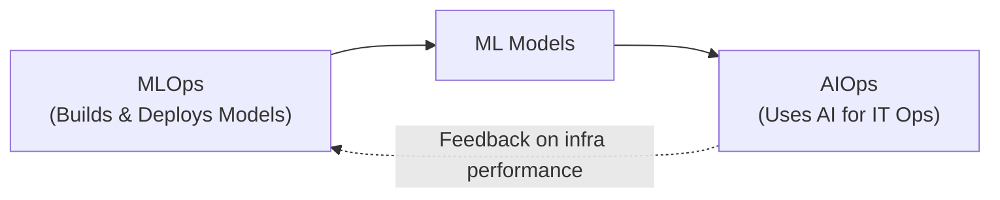
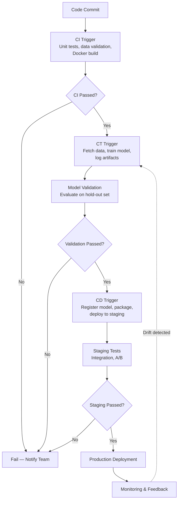
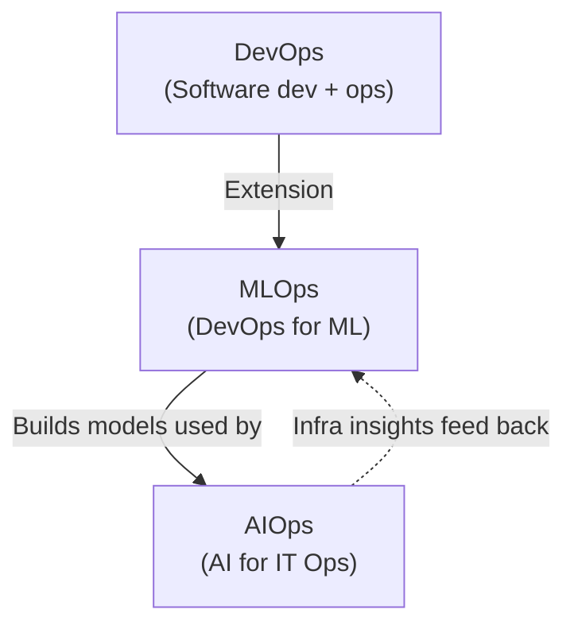

```markdown
# Week-01/Module-02-Lesson-02-Core-Concepts-and-Production-Terminology.md

# Lesson 2 of 80 — Core Concepts & Production Terminology


**Module 1: Foundations of AI Deployment & Production Readiness**

---

## Table of Contents

1. [Introduction: Navigating the AI Production Landscape](#introduction-navigating-the-ai-production-landscape)
2. [Defining MLOps: The Backbone of AI Production](#defining-mlops-the-backbone-of-ai-production)
3. [DevOps for AI: Extending the DevOps Philosophy](#devops-for-ai-extending-the-devops-philosophy)
4. [AIOps: Intelligence for Operations](#aiops-intelligence-for-operations)
5. [Mastering Model Versioning, Artifact Management, and Reproducibility](#mastering-model-versioning-artifact-management-and-reproducibility)
6. [Understanding Inference, Latency, Throughput, and Scalability](#understanding-inference-latency-throughput-and-scalability)
7. [Introduction to CI/CD for Machine Learning](#introduction-to-cicd-for-machine-learning)
8. [Quick Reference Summary](#quick-reference-summary)

---

## Introduction: Navigating the AI Production Landscape


Welcome to the foundational module of our AI Deployment, Automation & Real-World Applications course. In this lesson, **Core Concepts & Production Terminology**, we will lay the groundwork for understanding how Artificial Intelligence models transition from experimental prototypes to robust, production-ready systems. For B-Tech students aiming to master AI/ML deployment, grasping these core concepts is paramount. This lesson is designed to equip you with the essential vocabulary and conceptual understanding needed to navigate the complexities of bringing AI solutions to life.

The AI model deployment lifecycle is a journey, not a destination. It involves a series of stages, from initial model development and training to rigorous testing, deployment, monitoring, and continuous improvement. Understanding this lifecycle is crucial for ensuring that your AI models not only perform well in controlled environments but also deliver consistent value and reliability in real-world applications. This module directly addresses the learning objective: **Understand the AI model deployment lifecycle.**

Furthermore, we will delve into the critical terminology that defines the field of AI production. Terms like **MLOps, DevOps for AI, AIOps, model versioning, artifact management, reproducibility, inference, latency, throughput, and scalability** are not just buzzwords; they are the building blocks of efficient and effective AI systems. By the end of this lesson, you will be able to **define key terms related to AI production**, which is a core learning objective.

Successful AI deployment hinges on several prerequisites. These include a well-defined strategy, appropriate infrastructure, robust data pipelines, and a skilled team. We will touch upon these prerequisites, helping you to **identify prerequisites for successful AI deployment**. Finally, we will explore why adopting sound deployment strategies is not merely a technical necessity but a strategic advantage. Robust deployment strategies lead to faster time-to-market, improved model performance, enhanced reliability, and ultimately, greater business impact. This aligns with our objective to **outline the benefits of robust deployment strategies**.

The tools we will be using throughout this course, such as **Python, Docker, Kubernetes, cloud platforms (AWS/GCP/Azure), Git, FastAPI, LangChain, LlamaIndex, vLLM, LangGraph, Evidently AI, and Streamlit/Gradio**, are powerful enablers of AI deployment. While this specific lesson focuses on the conceptual underpinnings, the knowledge gained here will be directly applicable as we begin to utilize these tools in subsequent lessons. Prepare to build a solid foundation for your journey into the world of AI production.

---

## Defining MLOps: The Backbone of AI Production


At the heart of successful AI deployment lies **MLOps**, a portmanteau of **Machine Learning** and **Operations**. MLOps is a set of practices, principles, and tools that aims to deploy and maintain machine learning models in production reliably and efficiently. It is essentially the application of DevOps principles to the machine learning lifecycle.

### What is MLOps?

MLOps is a discipline that seeks to automate and streamline the end-to-end machine learning lifecycle. This lifecycle encompasses data gathering, model training, model validation, deployment, monitoring, and retraining. The primary goal of MLOps is to **bridge the gap between data science teams (who build models) and operations teams (who deploy and manage them)**, ensuring that models can be developed, tested, deployed, and managed with the same rigor and efficiency as traditional software.

### Key Characteristics of MLOps

| Characteristic | Description |
|---|---|
| **Automation** | Automating as many stages of the ML lifecycle as possible, from data ingestion and preprocessing to model training, testing, deployment, and monitoring. |
| **Collaboration** | Fostering seamless collaboration between data scientists, ML engineers, software engineers, and operations teams. |
| **Reproducibility** | Ensuring that experiments and model deployments can be reproduced consistently. |
| **Scalability** | Designing systems that can handle increasing volumes of data and user traffic. |
| **Monitoring** | Continuously monitoring model performance in production to detect drift, degradation, or anomalies. |
| **CI/CD/CT** | Implementing automated pipelines for integrating new code, delivering models, and retraining them based on new data or performance metrics. |

### Why is MLOps Important?

The importance of MLOps cannot be overstated in today's AI-driven landscape. Without a structured MLOps approach, organizations often face significant challenges:

- **Slow Deployment Cycles:** Manual processes for testing and deploying models can be time-consuming, leading to delays in getting valuable AI solutions into the hands of users.
- **Model Degradation:** Models trained on historical data can become less accurate over time as real-world data patterns change (data drift and concept drift). Without proper monitoring and retraining, their performance degrades, leading to poor business outcomes.
- **Lack of Reproducibility:** Inability to reproduce past experiments or model versions makes debugging, auditing, and improving models extremely difficult.
- **Scalability Issues:** Models that work well on a small dataset might fail to scale when deployed to handle millions of requests.
- **Compliance and Governance:** Ensuring that AI models comply with regulatory requirements and internal governance policies is challenging without proper versioning and auditing capabilities.
- **High Operational Costs:** Inefficient processes and manual interventions can lead to increased operational costs and resource wastage.

MLOps addresses these challenges by providing a framework for managing the entire ML lifecycle with a focus on **automation, reliability, and efficiency**.

---

## DevOps for AI: Extending the DevOps Philosophy


MLOps is fundamentally an extension of **DevOps** principles, tailored for the unique challenges of machine learning. DevOps, which stands for **Development and Operations**, aims to shorten the systems development life cycle and provide continuous delivery with high software quality. It emphasizes collaboration and communication between software developers and IT operations professionals.

When applied to AI, DevOps principles are adapted to accommodate the iterative and experimental nature of machine learning development:

| DevOps Aspect | MLOps Adaptation |
|---|---|
| **Code vs. Model** | In traditional DevOps, the focus is on code. In MLOps, the focus is on both code (for data processing, feature engineering, model training scripts) and models themselves (the trained artifacts). |
| **Data as a First-Class Citizen** | Data is as critical as code in ML. MLOps requires robust data management, versioning, and validation strategies. |
| **Experimentation and Iteration** | ML development is inherently experimental. MLOps needs to support tracking experiments, managing different model versions, and facilitating rapid iteration. |
| **Model Validation and Monitoring** | Beyond code testing, ML models require continuous validation against new data and ongoing monitoring for performance degradation. |

The synergy between DevOps and ML is crucial. A well-established DevOps culture within an organization provides a strong foundation for adopting MLOps. It means teams are already accustomed to practices like version control, automated testing, continuous integration, and continuous deployment.

---

## AIOps: Intelligence for Operations


While **MLOps** focuses on the ML lifecycle, **AIOps** (Artificial Intelligence for IT Operations) leverages AI and machine learning to automate and enhance IT operations. AIOps platforms ingest vast amounts of data from various IT systems (logs, metrics, events) and use AI algorithms to detect anomalies, predict issues, automate remediation, and provide insights into system performance and health.

### The Relationship Between MLOps and AIOps

The relationship between MLOps and AIOps is **complementary**:

- **MLOps** builds and deploys ML models.
- **AIOps** uses AI (often models built via MLOps) to improve IT operations.



*For instance, an AIOps platform might use a machine learning model to predict potential server failures. This model itself would have been developed, deployed, and monitored using MLOps practices. Conversely, MLOps pipelines can benefit from AIOps insights. If an AIOps system detects performance bottlenecks in the infrastructure where ML models are deployed, this information can be fed back into the MLOps process to optimize resource allocation or model efficiency.*

In essence, **MLOps is about applying operational excellence to the ML development and deployment process**, while **AIOps is about using AI to make IT operations smarter and more automated**. Both are critical for building resilient and efficient AI-powered systems.

### How to Implement MLOps Principles (Conceptual)

Implementing MLOps is a journey that involves adopting specific tools and processes. While detailed implementation will be covered in later modules, the core principles involve:

1. **Version Control Everything:** Not just code, but also data, configurations, and models.
2. **Automate Pipelines:** Build CI/CD/CT pipelines for ML workflows.
3. **Monitor Continuously:** Track model performance, data drift, and system health.
4. **Establish Governance:** Implement policies for model development, deployment, and ethical AI usage.
5. **Foster Collaboration:** Break down silos between teams.

### Real-World Scenarios

- **E-commerce Recommendation Systems:** MLOps ensures that recommendation models are continuously updated with new user behavior data, deployed quickly to reflect trending items, and monitored for accuracy.
- **Fraud Detection:** Financial institutions use MLOps to deploy and update fraud detection models in real-time, minimizing false positives and negatives. AIOps might monitor the infrastructure supporting these models for performance issues.
- **Autonomous Vehicles:** The complex ML models powering self-driving cars require rigorous MLOps for continuous training, validation, and safe deployment, with AIOps ensuring the operational stability of the entire system.

Understanding MLOps is the first crucial step in mastering AI deployment. It provides the framework for managing the entire lifecycle of an AI model, ensuring its reliability, scalability, and continuous improvement in production environments.

---

## Mastering Model Versioning, Artifact Management, and Reproducibility


In the realm of AI production, the ability to precisely track, manage, and recreate models and their associated components is not a luxury, but a necessity. This section delves into three interconnected concepts that are fundamental to robust AI deployment: **model versioning, artifact management, and reproducibility**.

### Understanding Model Versioning

#### What is Model Versioning?

Model versioning is the practice of assigning unique identifiers to different iterations of a machine learning model. Just as software code is versioned using tools like Git, machine learning models and their associated artifacts (data, code, parameters) must also be versioned. Each version represents a specific state of the model, often corresponding to a particular training run, dataset, or set of hyperparameters.

**A model version typically includes:**

| Component | Description |
|---|---|
| **The trained model file(s)** | The serialized model object (e.g., a `.pkl` file for scikit-learn, a `saved_model` directory for TensorFlow, or a PyTorch `.pth` file). |
| **The training code** | The specific script or notebook used to train the model. |
| **The training data** | The dataset (or a specific snapshot/version of it) used for training. |
| **Hyperparameters** | The configuration settings used during training. |
| **Evaluation metrics** | The performance metrics achieved by the model on validation or test sets. |
| **Environment details** | The libraries and their versions used for training and inference. |

#### Why is Model Versioning Important?

- **Rollback Capabilities:** If a newly deployed model performs poorly or introduces unexpected issues, versioning allows for a quick and safe rollback to a previously known good version.
- **Auditing and Compliance:** For regulated industries, it's essential to be able to audit which model version was used for a specific decision or prediction, and to trace its lineage.
- **Experiment Tracking:** When experimenting with different model architectures, hyperparameters, or datasets, versioning helps in organizing and comparing the results of various training runs.
- **Debugging:** If a model behaves unexpectedly in production, versioning allows engineers to pinpoint the exact version and its associated artifacts to diagnose the problem.
- **Reproducibility:** A well-versioned model and its components are the first step towards achieving reproducibility.

#### How to Implement Model Versioning (Conceptual)

Model versioning is typically managed through specialized tools or platforms:

- **Model Registries:** Tools like MLflow, SageMaker Model Registry, Vertex AI Model Registry, or Azure ML Model Registry provide centralized repositories for storing, organizing, and managing model versions.
- **Experiment Tracking Tools:** These tools log parameters, metrics, and artifacts for each training run, effectively creating versions of experiments and their resulting models.
- **Version Control Systems (for code and data):** While not directly for models, Git for code and tools like DVC (Data Version Control) for data are essential complements to model versioning.

### Artifact Management: The Supporting Cast

#### What is Artifact Management?

Artifact management refers to the systematic process of storing, organizing, tracking, and retrieving all the outputs and dependencies generated during the machine learning lifecycle. These outputs are collectively known as **artifacts**.

**Artifacts in ML include:**

| Artifact Type | Examples |
|---|---|
| **Trained Models** | The core output of the training process. |
| **Datasets** | Raw data, preprocessed data, feature sets. |
| **Code** | Training scripts, inference scripts, data processing pipelines. |
| **Configuration Files** | Hyperparameters, environment settings, deployment configurations. |
| **Metrics and Logs** | Performance metrics, training logs, experiment results. |
| **Pre-trained Embeddings or Weights** | Components used in transfer learning. |
| **Docker Images** | Containerized environments for consistent deployment. |

#### Why is Artifact Management Important?

- **Reproducibility:** Without managing all artifacts, reproducing a model's behavior is impossible.
- **Traceability:** Understanding the lineage of a model – how it was trained, with what data, and under what conditions.
- **Collaboration:** Allowing team members to easily access and share necessary artifacts.
- **Efficiency:** Avoiding redundant computations by reusing pre-computed artifacts.
- **Deployment:** Ensuring that the correct artifacts are packaged and deployed with the model.

#### How to Implement Artifact Management (Conceptual)

Artifact management is often integrated into MLOps platforms and tools:

- **Model Registries:** As mentioned, these store model artifacts and their metadata.
- **Artifact Repositories:** Tools like Nexus Repository Manager, Artifactory, or cloud-based object storage (S3, GCS, Azure Blob Storage) can be used to store various types of artifacts.
- **Experiment Tracking Tools:** These tools automatically log and store artifacts associated with each experiment run.
- **Data Versioning Tools (e.g., DVC):** Specifically designed to manage large data files alongside Git repositories.

### Ensuring Reproducibility: The Holy Grail of ML

#### What is Reproducibility?

Reproducibility in machine learning means that an experiment or a model's outcome can be consistently recreated given the same conditions. This implies being able to reproduce not just the final model, but also the exact results of the training process, including metrics and intermediate outputs.

**Achieving reproducibility requires meticulous tracking and management of:**

| Component | Description |
|---|---|
| **Code** | Using version control (Git) with specific commit hashes. |
| **Data** | Versioning the exact dataset used for training and evaluation. |
| **Environment** | Specifying and locking down all dependencies (libraries, their versions, operating system). |
| **Parameters** | Recording all hyperparameters and configuration settings. |
| **Random Seeds** | Setting random seeds for all stochastic processes (e.g., weight initialization, data shuffling) to ensure deterministic outcomes. |

#### Why is Reproducibility Important?

- **Trust and Validation:** Enables others (or yourself later) to verify your results.
- **Debugging:** Essential for identifying the root cause of errors or unexpected behavior.
- **Collaboration:** Allows team members to build upon each other's work reliably.
- **Auditing and Compliance:** Critical for regulatory requirements and demonstrating model integrity.
- **Scientific Rigor:** A cornerstone of scientific research and development.

#### How to Achieve Reproducibility (Conceptual)

1. **Use Git for Code:** Commit all code changes with descriptive messages and tag important versions.
2. **Version Data:** Employ tools like DVC or store specific data snapshots in object storage with version identifiers.
3. **Containerize Environments:** Use Docker to package your code and dependencies, ensuring consistency across different machines and deployment stages.
4. **Log Everything:** Use experiment tracking tools to log hyperparameters, metrics, code versions, and data versions for every run.
5. **Set Random Seeds:** Explicitly set random seeds for libraries like NumPy, TensorFlow, PyTorch, and scikit-learn.
6. **Document Thoroughly:** Maintain clear documentation of the entire process.

### Real-World Scenarios

- **Drug Discovery:** A pharmaceutical company needs to reproduce the exact conditions under which a promising drug efficacy model was trained to validate its findings for regulatory submission.
- **Financial Modeling:** A bank must be able to reproduce the exact model and data used for a risk assessment to comply with financial regulations and for internal audits.
- **Research Publication:** Academic researchers must provide sufficient detail (code, data, environment) for their work to be reproducible by others, a standard practice in scientific publishing.

By diligently implementing model versioning, artifact management, and striving for reproducibility, you build a foundation of trust, efficiency, and reliability for your AI systems, making them easier to manage, debug, and improve over time.

---

## Understanding Inference, Latency, Throughput, and Scalability


Once an AI model is trained and deployed, its performance in a live environment is judged by how quickly and efficiently it can process requests. This section focuses on key concepts related to model execution in production: **inference, latency, throughput, and scalability**. These metrics are vital for ensuring a positive user experience and efficient resource utilization.

### Concepts of Inference

#### What is Inference?

Inference, in the context of machine learning, refers to the process of using a trained model to make predictions on new, unseen data. It is the stage where the model is put to work to solve the problem it was designed for. For example, if a model was trained to classify images, inference is the process of feeding a new image to the model and getting a prediction (e.g., 'cat', 'dog'). If a model was trained to predict house prices, inference is taking new house features (size, location, number of rooms) and getting a predicted price.

**The inference process typically involves:**


1. **Data Preprocessing:** New input data is transformed into the format expected by the model (e.g., resizing images, tokenizing text, scaling numerical features).
2. **Model Execution:** The preprocessed data is fed into the trained model's architecture.
3. **Prediction Generation:** The model computes its output, which is the prediction.
4. **Post-processing:** The model's raw output might be further processed to be more interpretable or actionable (e.g., converting probabilities to class labels, formatting a generated text response).

#### Why is Inference Important?

Inference is the ultimate goal of training an ML model. Without effective inference, the model has no practical value. The efficiency and accuracy of inference directly impact the user experience and the business value derived from the AI system.

#### How to Implement Inference (Conceptual)

Inference is typically performed by loading the trained model into memory and then calling a prediction function. This can be done in various ways:

| Inference Type | Description |
|---|---|
| **Batch Inference** | Processing a large number of data points simultaneously. Often used for tasks like generating daily reports or updating recommendation lists. |
| **Real-time (Online) Inference** | Processing individual data points as they arrive, providing immediate predictions. Common for chatbots, fraud detection, or live recommendations. |
| **Edge Inference** | Performing inference directly on devices (e.g., smartphones, IoT devices) rather than sending data to a central server. |

Tools like FastAPI, Flask, or cloud-specific inference endpoints (e.g., AWS SageMaker Endpoints, GCP Vertex AI Endpoints) are used to serve models for inference.

### Latency: The Speed of a Single Prediction

#### What is Latency?

Latency refers to the time delay between when a request is sent to an AI model for inference and when the response (prediction) is received. It is essentially the time it takes for a single data point to travel through the entire inference pipeline. Latency is typically measured in **milliseconds (ms) or seconds (s)**.

#### Why is Latency Important?

Low latency is crucial for applications that require immediate responses:

- **User Experience:** High latency can lead to a sluggish and frustrating user experience in interactive applications.
- **Real-time Decision Making:** In time-sensitive applications like autonomous driving or high-frequency trading, even small delays can have significant consequences.
- **System Responsiveness:** For systems that rely on rapid sequential predictions, high latency can cascade and impact overall system performance.

#### How to Reduce Latency (Conceptual)

| Technique | Description |
|---|---|
| **Model Optimization** | Quantization (reducing precision of model weights), pruning (removing less important connections), knowledge distillation (training a smaller model to mimic a larger one). |
| **Efficient Inference Engines** | Using optimized libraries and runtimes like vLLM, TensorRT, or ONNX Runtime. |
| **Hardware Acceleration** | Utilizing GPUs, TPUs, or specialized AI accelerators. |
| **Edge Deployment** | Performing inference closer to the data source. |
| **Caching** | Storing results of frequently requested predictions. |

### Throughput: The Volume of Predictions per Unit Time

#### What is Throughput?

Throughput measures the number of inference requests that an AI system can successfully process within a given period, typically per second. It represents the system's capacity to handle a load of requests. Throughput is often measured in **requests per second (RPS) or inferences per second (IPS)**.

#### Why is Throughput Important?

High throughput is essential for applications that need to serve a large number of users or process a high volume of data:

- **Scalability:** A system with high throughput can handle more concurrent users or a larger data stream.
- **Cost Efficiency:** Maximizing throughput on existing hardware can reduce the need for additional infrastructure, leading to cost savings.
- **Service Level Agreements (SLAs):** Many services have SLAs that guarantee a certain level of throughput.

#### How to Increase Throughput (Conceptual)

| Technique | Description |
|---|---|
| **Parallelization** | Processing multiple requests concurrently via multi-threading, multi-processing, or distributed systems. |
| **Batching** | Grouping multiple inference requests together and processing them as a single batch. Effective when latency requirements are not extremely strict. |
| **Optimized Hardware** | Using powerful GPUs or multiple inference servers. |
| **Efficient Model Serving Frameworks** | Employing frameworks designed for high-throughput inference, such as vLLM or Triton Inference Server. |
| **Load Balancing** | Distributing incoming requests across multiple model instances. |

### Scalability: Adapting to Changing Demands

#### What is Scalability?

Scalability refers to the ability of an AI system to handle an increasing amount of work or demand by adding resources. A scalable system can gracefully accommodate growth in user traffic, data volume, or computational complexity without a significant degradation in performance.

**There are two main types of scalability:**

| Type | Description |
|---|---|
| **Vertical Scalability (Scaling Up)** | Increasing the capacity of a single machine by adding more resources like CPU, RAM, or a more powerful GPU. |
| **Horizontal Scalability (Scaling Out)** | Adding more machines or instances to distribute the workload. Generally preferred for large-scale systems as it offers greater flexibility and fault tolerance. |

#### Why is Scalability Important?

- **Handling Growth:** As user bases grow or data volumes increase, the system must be able to cope.
- **Cost Management:** Scalability allows for dynamic resource allocation, meaning you only pay for the resources you need at any given time.
- **Reliability and Availability:** Horizontal scalability can improve fault tolerance; if one instance fails, others can take over.
- **Performance Consistency:** Ensuring that performance remains acceptable even under peak load.

#### How to Achieve Scalability (Conceptual)

| Technique | Description |
|---|---|
| **Cloud Infrastructure** | Leveraging cloud platforms (AWS, GCP, Azure) that offer auto-scaling capabilities for compute, storage, and networking. |
| **Containerization (Docker) and Orchestration (Kubernetes)** | Docker packages applications and dependencies; Kubernetes automates deployment, scaling, and management of containerized applications. |
| **Microservices Architecture** | Breaking down a large application into smaller, independent services that can be scaled individually. |
| **Load Balancers** | Distributing incoming traffic across multiple instances of a service. |
| **Stateless Design** | Designing services so that they do not store session-specific data locally, making it easier to add or remove instances. |

### Real-World Scenarios

- **Social Media Feed Generation:** A platform like Instagram needs to serve millions of users with personalized feeds. This requires extremely low latency for displaying content and very high throughput to handle the massive user base. Scalability is paramount to handle peak times like holidays.
- **Online Gaming:** Real-time multiplayer games demand ultra-low latency for player actions and high throughput to manage concurrent players. The system must scale dynamically with player numbers.
- **Customer Support Chatbots:** A chatbot needs to respond quickly (low latency) to customer queries and handle thousands of concurrent conversations (high throughput). The system must scale to accommodate fluctuating customer service demand.

Mastering these concepts—inference, latency, throughput, and scalability—is essential for designing and deploying AI models that are not only accurate but also performant, reliable, and cost-effective in real-world production environments.

---

## Introduction to CI/CD for Machine Learning


**Continuous Integration (CI)** and **Continuous Delivery/Deployment (CD)** are foundational practices in modern software engineering. When applied to machine learning, they evolve into **CI/CD/CT (Continuous Integration, Continuous Delivery, and Continuous Training)**, forming the backbone of an effective MLOps strategy. This section introduces these concepts and their significance in automating the ML lifecycle.

### What is CI/CD for ML?

CI/CD for ML, often referred to as **CI/CD/CT**, is a set of practices and a framework for automating the build, test, and deployment of machine learning models and their associated code. It aims to enable faster, more reliable, and more frequent releases of ML-powered applications.

**Let's break down the components:**

| Component | Description |
|---|---|
| **Continuous Integration (CI)** | Automatically merging code changes from multiple developers into a shared repository frequently. Each integration is verified by an automated build and test process. For ML, this extends to validating data pipelines and performing initial model validation checks. |
| **Continuous Delivery (CD)** | Ensures that code (and models) that passes the CI stage can be released to production at any time. For ML, this involves packaging the model and its dependencies into a deployable artifact (e.g., a Docker image). |
| **Continuous Deployment (CD — alternative meaning)** | Automatically deploying every change that passes all stages of the pipeline to production. More aggressive than Continuous Delivery. |
| **Continuous Training (CT)** | The ML-specific addition. Automatically retraining models when new data becomes available, when model performance degrades, or on a scheduled basis. The newly trained model then goes through the CI/CD pipeline for validation and potential deployment. |

### Why is CI/CD for ML Important?

Implementing CI/CD/CT pipelines for ML offers substantial benefits:

- **Faster Time-to-Market:** Automating the release process significantly reduces the time it takes to get new models or model updates into production, allowing businesses to leverage insights and features more quickly.
- **Reduced Risk:** Frequent, small releases are less risky than large, infrequent ones. Automated testing catches issues early, preventing them from reaching production.
- **Improved Model Quality:** Continuous training and monitoring ensure that models remain accurate and relevant as data patterns evolve.
- **Increased Efficiency:** Automating repetitive tasks frees up data scientists and engineers to focus on more complex problems and innovation.
- **Enhanced Reproducibility:** CI/CD pipelines inherently enforce versioning and consistent environments, contributing to reproducibility.
- **Better Collaboration:** Standardized pipelines facilitate smoother collaboration among team members.

### How CI/CD/CT Works in Practice (Conceptual Flow)

A typical CI/CD/CT pipeline for ML might look like this:



1. **Code Commit:** A data scientist or ML engineer commits code changes (e.g., new feature engineering script, model architecture update) to a Git repository.
2. **CI Trigger:** The commit triggers a CI pipeline. This pipeline might:
   - Run unit tests on the code.
   - Validate the data schema and perform basic data quality checks.
   - Execute a lightweight training run or a model validation script.
   - Build a Docker image containing the code and its dependencies.
3. **Model Training (CT Trigger):** If the CI stage passes, and if new data is available or a performance threshold is met, a CT pipeline is triggered. This pipeline:
   - Fetches the latest data.
   - Trains the model using the updated code and data.
   - Logs hyperparameters, metrics, and the trained model artifact.
4. **Model Validation:** The newly trained model is evaluated against predefined metrics on a hold-out dataset.
5. **CD Trigger:** If the model validation is successful, a CD pipeline is triggered. This pipeline might:
   - Register the model in a model registry.
   - Package the model and its inference code into a deployable artifact (e.g., a new Docker image).
   - Deploy the artifact to a staging environment for further testing.
6. **Staging and Production Deployment:** After successful testing in staging (e.g., integration tests, A/B testing), the model can be automatically deployed to production or manually approved for deployment.
7. **Monitoring and Feedback:** Once in production, the model's performance is continuously monitored. If performance degrades (e.g., due to data drift), this can trigger another CT cycle.

### Tools for CI/CD/CT in ML

A variety of tools can be orchestrated to build these pipelines:

| Category | Tools |
|---|---|
| **Version Control** | Git (GitHub, GitLab, Bitbucket) |
| **CI/CD Orchestration** | Jenkins, GitLab CI, GitHub Actions, Azure DevOps, CircleCI |
| **Containerization** | Docker |
| **Orchestration** | Kubernetes |
| **Experiment Tracking & Model Registries** | MLflow, SageMaker, Vertex AI, Azure ML |
| **Data Versioning** | DVC |
| **Testing Frameworks** | Pytest, Unittest |
| **Monitoring Tools** | Evidently AI, Prometheus, Grafana |

### Real-World Scenarios

- **E-commerce Personalization:** A retail company uses CI/CD/CT to continuously update its recommendation engine. When new customer purchase data arrives, the CT pipeline retrains the model, and if performance improves, it's automatically deployed to serve personalized recommendations.
- **Spam Detection:** An email service provider uses CI/CD/CT to keep its spam filters up-to-date. New spam patterns are identified, triggering retraining (CT), and the updated filter is deployed rapidly (CD) to protect users.
- **Medical Image Analysis:** A healthcare startup uses CI/CD/CT to deploy updated diagnostic models. Rigorous validation in staging ensures that any new model version meets strict accuracy and safety standards before being deployed to assist clinicians.

Implementing CI/CD/CT is a significant step towards mature MLOps. It transforms the ML development process from a manual, error-prone endeavor into an automated, reliable, and efficient workflow, enabling organizations to fully harness the power of AI.

---

## Quick Reference Summary

### Key Terms at a Glance

| Term | Definition |
|---|---|
| **MLOps** | Practices, principles, and tools to deploy and maintain ML models in production reliably and efficiently. |
| **DevOps for AI** | Extension of DevOps principles adapted for ML's iterative and experimental nature. |
| **AIOps** | Using AI/ML to automate and enhance IT operations (anomaly detection, remediation, etc.). |
| **Model Versioning** | Assigning unique identifiers to different iterations of an ML model and its artifacts. |
| **Artifact Management** | Systematic storage, organization, and retrieval of all ML lifecycle outputs. |
| **Reproducibility** | Ability to consistently recreate an experiment or model outcome given the same conditions. |
| **Inference** | Using a trained model to make predictions on new, unseen data. |
| **Latency** | Time delay between request and response for a single prediction. |
| **Throughput** | Number of inference requests processed per unit time (RPS/IPS). |
| **Scalability** | Ability to handle increasing workload by adding resources (vertical or horizontal). |
| **CI/CD/CT** | Continuous Integration, Continuous Delivery, Continuous Training — automated ML pipelines. |

### MLOps vs. AIOps vs. DevOps



| Aspect | DevOps | MLOps | AIOps |
|---|---|---|---|
| **Focus** | Software code | ML models + code + data | IT operations |
| **Primary Goal** | Fast, reliable software delivery | Reliable ML deployment & lifecycle | Smarter, automated IT ops |
| **Key Addition** | CI/CD | CI/CD/CT + data versioning | AI-driven anomaly detection |
| **Data Role** | Secondary | First-class citizen | Input signal for analysis |

### Latency vs. Throughput vs. Scalability

| Concept | Question It Answers | Unit |
|---|---|---|
| **Latency** | How fast is one prediction? | ms / s |
| **Throughput** | How many predictions per second? | RPS / IPS |
| **Scalability** | Can the system grow with demand? | Qualitative + resource metrics |

*End of Lesson 2 of 80*
```